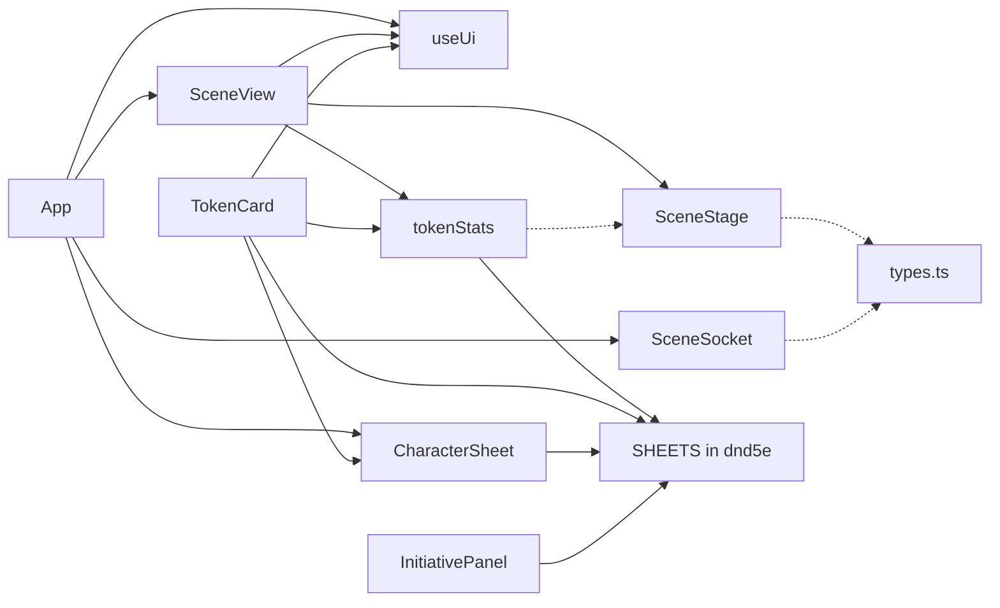

# FSD Stage 1 — фактическая архитектура и риски

## Область и метод

Аудит frontend Laterna VTT выполнен на `master`
`1b215596cb9cb1917ba8fce3f249d1c7789d2df5`, ветка
`docs/fsd-architecture-audit`. Это анализ, не выполненная миграция.
Исходники, тесты, зависимости, wire protocol и сохранения не изменялись.
Целевая модель и последовательность PR — [FSD_MIGRATION_PLAN.md](FSD_MIGRATION_PLAN.md).

Прочитаны entrypoint, orchestration, renderer/React bridge, store/socket,
модули sheets/ui/shared, DTO, unit/browser fixtures; backend — в пределах
контрактов handlers/protocol/serialization/permissions/sheet data.
Статический граф построен TypeScript AST и resolveModuleName в режиме Bundler:
import, re-export, import type и строковый dynamic import; runtime и type-only
рёбра учитывались отдельно. Метрики ниже относятся к `web/src`, а не node_modules
или тестам. Число строк — размер на этой базе, не самостоятельный критерий качества.

Документальные источники:
[архитектура](ARCHITECTURE.md), [roadmap](ROADMAP.md),
[Design System](DESIGN_SYSTEM.md), [разработка](DEVELOPMENT.md),
[CI/CD](CI_CD.md), [checklist](CHECKLIST.md), [баги](BUGS.md),
[расследование token link](E2E_TOKEN_LINK_SYNC.md),
[концепции Book](BETA_BOOK_CONCEPTS.md), [библиотека ассетов](ASSET_LIBRARY_SPEC.md).
Разделы «отложено»/«следующий этап» не считаются реализованными функциями.
В частности, освещение имеет поля в модели, но полного LOS/light engine сейчас нет.

## Актуальные пути после механического переноса FSD-05

Дерево, метрики и выводы ниже остаются историческим AS-IS базы аудита
`1b215596cb9cb1917ba8fce3f249d1c7789d2df5`, а не текущим перечнем файлов.
После объединения PR #17 renderer находится в
[widgets/scene-canvas/lib/stage.ts](../web/src/widgets/scene-canvas/lib/stage.ts),
React bridge — в
[widgets/scene-canvas/ui/SceneView.tsx](../web/src/widgets/scene-canvas/ui/SceneView.tsx).
Реализация, callbacks и hotfix PR #15 сохранены; изменены только import paths.
Fixture использует `/src/widgets/scene-canvas/lib/stage.ts` и проверяет идентичность
класса приложения. Исходный URL в разделе 7 относится к исторической базе аудита.
Legacy store/tokenStats перечислены в
[плане, завершённый FSD-05](FSD_MIGRATION_PLAN.md#завершённый-этап-fsd-05).
Type-only зависимость Sidebar от SceneStage устранена в FSD-06a через существующий
TokenPlacementPort; исторические метрики ниже не пересчитываются.
Рост shader cache остаётся отдельной [Issue #16](https://github.com/LunierVeil/Laterna-VTT/issues/16).

## Актуальные пути FSD-06a

Исторические дерево, метрики и риски далее относятся только к базе аудита выше.
В FSD-06a текущие реализации находятся в:

- [features/dice/ui/DicePanel.tsx](../web/src/features/dice/ui/DicePanel.tsx)
- [features/dice/ui/DiceAnimation.tsx](../web/src/features/dice/ui/DiceAnimation.tsx)
- [features/dice/lib/diceDisplay.ts](../web/src/features/dice/lib/diceDisplay.ts)
- [features/chat/ui/Chat.tsx](../web/src/features/chat/ui/Chat.tsx)
- [widgets/sidebar/ui/Sidebar.tsx](../web/src/widgets/sidebar/ui/Sidebar.tsx)
- [widgets/table-header/ui/TopBar.tsx](../web/src/widgets/table-header/ui/TopBar.tsx)

Chat получает DicePanel через ReactNode-slot из Sidebar; sibling-feature import
chat → dice отсутствует. Обновлены unit/test imports, но старые пути в историческом
дереве AS-IS сохранены. Текущая композиция и legacy allowlist описаны в
[FSD_MIGRATION_PLAN](FSD_MIGRATION_PLAN.md#завершённый-этап-fsd-06a).

## Актуальные пути FSD-06b

FSD-06b объединён в [PR #19](https://github.com/LunierVeil/Laterna-VTT/pull/19),
master `9429255110762e06778b74c07b5f79f48acf10d9`, с успешным
[Full CI master](https://github.com/LunierVeil/Laterna-VTT/actions/runs/41713926052).
Исторический AS-IS, метрики и ADR далее не пересчитываются. В FSD-06b
ownership перенесён механически, без изменения bodies и сохранённых contracts:

- [ScenesPanel](../web/src/features/scene-management/ui/ScenesPanel.tsx) → features/scene-management/ui.
- [MapSettings](../web/src/features/scene-management/ui/MapSettings.tsx) → features/scene-management/ui.
- [PlayersPanel](../web/src/features/player-management/ui/PlayersPanel.tsx) → features/player-management/ui.
- [ToolRail](../web/src/features/scene-tools/ui/ToolRail.tsx) → features/scene-tools/ui.
- [SelectionBar](../web/src/features/scene-tools/ui/SelectionBar.tsx) → features/scene-tools/ui.
- [ZoomControl](../web/src/features/scene-tools/ui/ZoomControl.tsx) → features/scene-tools/ui.

MapSettings остаётся внутренним компонентом scene-management. Sidebar составляет
scene/player features; TablePage — scene-tools. Порты инструментов остаются в
entities; dependencies на SceneStage и runtime sibling-feature imports отсутствуют.
Все шесть компонентов сохраняют legacy useUi до отдельного FSD-08. На этапе 06b
CharactersPanel, TokenCard, InitiativePanel и CharacterSheet не перемещались;
актуальные пути первых трёх и SheetRow после 06c указаны ниже.
Текущие направления импортов и условия снятия исключений —
[план FSD-06b](FSD_MIGRATION_PLAN.md#завершённый-этап-fsd-06b).

## Актуальные пути FSD-06c

Этап объединён в PR #20; master `ab08d0b320950df4ab5cb5c72ebf66af11e41c94`,
[Full CI master](https://github.com/LunierVeil/Laterna-VTT/actions/runs/41732354372) — success.
Legacy-пути этого подраздела относятся к состоянию 06c; текущие пути FSD-07 ниже.

База — проверенный master PR #19 `9429255110762e06778b74c07b5f79f48acf10d9`.
Перенесены четыре канонические реализации:

- [features/character-management/ui/CharactersPanel.tsx](../web/src/features/character-management/ui/CharactersPanel.tsx).
- [features/character-management/ui/SheetRow.tsx](../web/src/features/character-management/ui/SheetRow.tsx) — внутренний компонент той же slice.
- [widgets/token-inspector/ui/TokenCard.tsx](../web/src/widgets/token-inspector/ui/TokenCard.tsx).
- [widgets/combat-tracker/ui/InitiativePanel.tsx](../web/src/widgets/combat-tracker/ui/InitiativePanel.tsx).

Изменены только module specifiers, Sidebar/TablePage imports и текущие разделы
документации. Bodies/JSX/keys, hooks/dependencies/refs, permissions, anchor cleanup,
InitInput, HP/temp HP, server commands и payload сохранены. Старых UI-копий и
compatibility re-export нет. Sibling-widget dependencies отсутствуют: TablePage
составляет оба widgets, Sidebar составляет character-management; SheetRow внутри slice.
TokenPlacementPort и TokenAnchorPort остаются нижними contracts, SceneStage не импортируется.

Точные legacy-исключения и условия удаления — в
[плане FSD-06c](FSD_MIGRATION_PLAN.md#завершённый-этап-fsd-06c):
все четыре компонента → state/store; CharactersPanel → sheets/tokenStats;
TokenCard → sheets/{dnd5e registry,tokenStats,bonus,HpControls}; InitiativePanel →
sheets/dnd5e registry. FSD-07 изменит физический ownership sheet-модулей, не правила;
FSD-09 отдельно удалит прямые системные imports через необходимые projections/UI seams.
FSD-06c выполняет только механический перенос, не system abstraction.
Store остаётся прежним до FSD-08; **пересмотр ADR D5 и согласование будущих зон
ответственности Zustand обязательны отдельно перед этим этапом**. Старый D5 —
историческое решение, не окончательное устройство store. Исторический AS-IS и
метрики далее сохранены. FSD-07/08/09 и исправление shader cache Issue #16 не начаты.

## Актуальные пути FSD-07

База — master `ab08d0b320950df4ab5cb5c72ebf66af11e41c94`. Перенесены 13 модулей:

- [legacy-sheet-schema](../web/src/entities/character/model/legacy-sheet-schema.ts) — прежний контракт schema.ts в entities/character/model.
- [dnd5e](../web/src/systems/dnd5e/model/dnd5e.ts), [mob](../web/src/systems/dnd5e/model/mob.ts),
  [equipment](../web/src/systems/dnd5e/model/equipment.ts), [bonus](../web/src/systems/dnd5e/model/bonus.ts),
  [tokenStats](../web/src/systems/dnd5e/model/tokenStats.ts) — systems/dnd5e/model.
- [sheetOps](../web/src/widgets/character-sheet/legacy/sheetOps.ts), [richDoc](../web/src/widgets/character-sheet/legacy/richDoc.ts),
  [RichText](../web/src/widgets/character-sheet/legacy/RichText.tsx), [DocEditor](../web/src/widgets/character-sheet/legacy/DocEditor.tsx),
  [Cards](../web/src/widgets/character-sheet/legacy/Cards.tsx), [SpellBook](../web/src/widgets/character-sheet/legacy/SpellBook.tsx),
  [CharacterSheet](../web/src/widgets/character-sheet/legacy/CharacterSheet.tsx) — единый character-sheet widget slice.

Это механический ownership move. Сохранены bodies, JSX/keys, hooks/dependencies,
единственный SheetOpsContext, lazy DocEditor, санитайзер и ресурсы rich documents,
HP/temp HP/mob templates, формулы и JSON paths, серверные list/counter/roll и права.
Source/unit test imports обновлены; assertions, manifest, expected counts и gate прежние.
TablePage меняет только импорт CharacterSheet. Нет sibling-widget imports: inspector
не импортирует character-sheet; общий прежний HpControls остаётся в sheets.

Исторические AS-IS, метрики и D1–D7 ниже не пересчитываются. Ссылки исторических
разделов на перенесённые модули закреплены на исходной базе аудита.
[Актуальный allowlist и направления](FSD_MIGRATION_PLAN.md#статус-fsd-07-в-текущем-pr):
legacy useUi до FSD-08; direct system imports/SHEETS и HpControls до FSD-09.
Пересмотр D5 перед FSD-08 обязателен отдельно; будущие зоны ответственности Zustand
здесь не утверждаются. Сам schema DSL остаётся legacy 5e-oriented, а не generic SDK.
FSD-08/09, backend decomposition/Alembic и обновление ROADMAP не начаты этим PR.
Issue #16 остаётся открытой и вне scope.

## 1. AS-IS: структура

Все пути дерева относительно `web/src/`:

```text
main.tsx                       React.StrictMode, шрифты, глобальный CSS
App.tsx                        доступ, загрузка, socket lifecycle, event routing, стол
styles.css                     глобальные layout/legacy classes/media queries
types.ts                      wire DTO, domain-shaped данные, Tool
net/
  socket.ts                    SceneSocket: seq, reconnect, pending, heartbeat
  upload.ts                    uploadImage, safeUpload
state/
  store.ts                     единый useUi, actions, SelectedToken, SideTab
scene/
  SceneView.tsx                React/Pixi/socket/store bridge
  stage.ts                     императивный renderer и взаимодействие
sheets/
  CharacterSheet.tsx            overlay, поля, blocks, поиск, HP, команды, импорт
  schema.ts                    DSL листа, включая prof/d20/abilities/spellbook
  dnd5e.ts, mob.ts, equipment.ts схемы; SHEETS registry находится в dnd5e.ts
  bonus.ts, tokenStats.ts       вычисления, HP changes, проекция на токен
  Cards.tsx, SpellBook.tsx      ресурсные карточки, заклинания 0–9
  RichText.tsx, richDoc.ts      безопасный документ, ссылки на ресурсы
  DocEditor.tsx, sheetOps.ts    lazy TipTap, локальный command context
ui/
  Login.tsx, TopBar.tsx, ToolRail.tsx, Sidebar.tsx
  Chat.tsx, DicePanel.tsx, DiceAnimation.tsx, diceDisplay.ts
  CharactersPanel.tsx, SheetRow.tsx, TokenCard.tsx
  ScenesPanel.tsx, MapSettings.tsx, PlayersPanel.tsx
  InitiativePanel.tsx, SelectionBar.tsx, ZoomControl.tsx
  ConfirmDialog.tsx, icons.tsx, input.ts
shared/
  styles/tokens.css
  ui/{Button,TextField,Checkbox,Panel,Tabs,Dialog,Tooltip,Select}/
    <Component>.tsx + <Component>.css
```

Всего 49 TS/TSX-модулей: root 3, net 2, state 1, scene 2, sheets 13,
ui 20, shared 8. React 18, Zustand 5, PixiJS 8, Vite 5, TypeScript,
TipTap 2; отдельного router/query cache/FSD dependency checker нет.
[package.json](../web/package.json), [tsconfig](../web/tsconfig.json),
[Vite](../web/vite.config.ts): относительные импорты, aliases не настроены,
TypeScript проверяет только src, moduleResolution=Bundler.

## 2. Граф зависимостей: что подтверждено

129 внутренних import/re-export occurrences: 84 runtime, 45 type-only.
Сильно связных компонент из нескольких модулей **нет** в обоих графах.
Статических циклов в исследованном src не обнаружено. Это не доказательство
отсутствия циклов в вычисляемых URL, callbacks, CSS или зависимостях npm.
Цикл «команда → сервер → событие → UI» — нормальный поток данных, не import cycle.

Fan-in/out ниже — число уникальных внутренних TS-модулей, включая type-only:

| Модуль | Строк | Fan-in | Fan-out | Интерпретация |
| --- | ---: | ---: | ---: | --- |
| [App](https://github.com/LunierVeil/Laterna-VTT/blob/1b215596cb9cb1917ba8fce3f249d1c7789d2df5/web/src/App.tsx) | 349 | 1 | 16 | композиция и несколько независимых lifecycle |
| [store](../web/src/state/store.ts) | 201 | 17 | 1 | все 17 входящих зависимостей runtime |
| [socket](https://github.com/LunierVeil/Laterna-VTT/blob/1b215596cb9cb1917ba8fce3f249d1c7789d2df5/web/src/net/socket.ts) | 176 | 15 | 1 | runtime-конструктор использует App; остальные 14 — type-only |
| [types](https://github.com/LunierVeil/Laterna-VTT/blob/1b215596cb9cb1917ba8fce3f249d1c7789d2df5/web/src/types.ts) | 175 | 15 | 0 | общий контракт, не runtime singleton |
| [stage](https://github.com/LunierVeil/Laterna-VTT/blob/1b215596cb9cb1917ba8fce3f249d1c7789d2df5/web/src/scene/stage.ts) | 1420 | 9 | 1 | 1 runtime consumer SceneView, остальные 8 — type-only |
| [CharacterSheet](https://github.com/LunierVeil/Laterna-VTT/blob/1b215596cb9cb1917ba8fce3f249d1c7789d2df5/web/src/sheets/CharacterSheet.tsx) | 1273 | 2 | 10 | App и TokenCard получают runtime-зависимость |
| [dnd5e](https://github.com/LunierVeil/Laterna-VTT/blob/1b215596cb9cb1917ba8fce3f249d1c7789d2df5/web/src/sheets/dnd5e.ts) | 373 | 4 | 3 | registry используют sheet, tokenStats, TokenCard, InitiativePanel |

Схема ключевых связей; `-->` runtime, `-.->` type-only:



Точный список 17 runtime consumers useUi на базе аудита: App.tsx,
scene/SceneView.tsx, sheets/CharacterSheet.tsx и ui/{CharactersPanel,Chat,DicePanel,
InitiativePanel,MapSettings,PlayersPanel,ScenesPanel,SelectionBar,SheetRow,Sidebar,
TokenCard,ToolRail,TopBar,ZoomControl}.tsx. Это исходная граница для будущего legacy
allowlist, а не разрешение добавлять новых consumers.

Существующие shared/ui не зависят от store, SceneSocket, игровых типов или
систем. Внутренняя связь Dialog → Button допустима. Это уже пригодный нижний слой,
а не объект для повторной реализации.

## 3. Фактические потоки и владение состоянием

### Запуск, доступ и смена сцены

[main](../web/src/main.tsx) монтирует StrictMode. [App](https://github.com/LunierVeil/Laterna-VTT/blob/1b215596cb9cb1917ba8fce3f249d1c7789d2df5/web/src/App.tsx)
на уровне модуля забирает gm/invite из URL и удаляет их из адресной строки.
Эффекты проверяют /api/me, первый вход ГМ, /api/characters и /api/campaign.
GM_SCENE=`lanterna.gmScene` хранит выбор сцены; campaign определяет допустимость
текущей сцены и перевод игрока на активную. Invite имеет приоритет над обычным
экраном входа. Это условные экраны одной SPA, router сейчас не нужен.

SceneSocket создаётся useMemo по sceneId и me.id; эффект подписывается до connect,
при смене сокета сбрасывает buffer/selection/chaining, при cleanup отписывается,
закрывает сокет и сбрасывает connected. App маршрутизирует scene/campaign,
character/reply, auth/error, chat/animation и preview/ping.

Socket обычно готов раньше Pixi: App сохраняет последний snapshot и следующие
scene events; handleReady применяет snapshot, затем события в исходном порядке.
Preview и ping до готовности stage не буферизуются. Нельзя превращать их в
персистентные события или переигрывать историю чата как анимацию бросков.

### Движение и отображение

[SceneView](https://github.com/LunierVeil/Laterna-VTT/blob/1b215596cb9cb1917ba8fce3f249d1c7789d2df5/web/src/scene/SceneView.tsx) создаёт SceneStage и связывает его
callbacks с socket.send. token.move имеет optimistic apply/revert; preview
передаёт base_seq из SceneSocket.sequence. Renderer хранит TokenView, Pixi nodes,
координаты, выделение, drag/ghost, fog, wall interactions и локальную историю undo.
Данные сцены — разрешённая сервером проекция; это не самостоятельный источник правды.

Mount асинхронный: cancelled-флаг, отложенный старт, isAlive и cleanup предотвращают
возврат уничтоженного StrictMode renderer. destroy отписывает listeners/tickers и
освобождает ресурсы. Перенос файлов не должен менять dependencies эффекта, порядок
stageRef/onReady, cleanup или создавать второй живой canvas.

SceneStage не импортирует React/store/socket/sheets; он получает callbacks,
DTO и CharacterStats. Выбор/изменение выбранного токена вызывает onSelect;
SceneView записывает SelectedToken в useUi. Координаты кадра туда не входят.
TokenCard.setAnchorListener обновляет DOM transform напрямую, не через React render.

### Store и локальные черновики

[store](../web/src/state/store.ts) содержит UI preferences и серверные проекции:
me/isGm/accounts, characters, combat, campaign metadata, messages/presence,
selected и selection counters, scene summary, инструменты, тосты, открытые панели.
Комментарий «только UI» не полностью отражает содержимое: characters/messages/combat
— кэш серверных данных. Однако полной коллекции Pixi tokens/walls в store нет.

Actions здесь преимущественно setters: без HTTP/socket и правил 5e. Исключения по
эффектам — localStorage diceAnimation, browser hardwareConcurrency и timers тостов.
setMe сбрасывает запрещённые GM-инструменты/вкладки, App отдельно очищает characters
при logout; это согласуемый lifecycle, не готовая атомарная session reset operation.

Selectors в основном inline в компонентах. Chat, TopBar и DiceMenu также используют
useUi() без selector. Это подписка на весь store; влияние на производительность
не измерялось, per-frame drag всё равно остаётся вне store.
Черновики FieldInput, Chat, sheet editing/search/tab, формы SpellBook и pending
PlayersPanel живут локально. Sidebar намеренно не размонтирует Chat при смене вкладки.

### Листы, вычисления и команды

[CharacterSheet](https://github.com/LunierVeil/Laterna-VTT/blob/1b215596cb9cb1917ba8fce3f249d1c7789d2df5/web/src/sheets/CharacterSheet.tsx) выбирает SHEETS[system],
рендерит DSL и содержит формы, block rendering, поиск, вычисления, HP controls,
портрет/upload, keyboard/overlay lifecycle, delete/reimport и отправку команд.
[SheetOpsContext](https://github.com/LunierVeil/Laterna-VTT/blob/1b215596cb9cb1917ba8fce3f249d1c7789d2df5/web/src/sheets/sheetOps.ts) уже даёт блокам операции list,
counter, roll без знания socket. Это существующая точка декомпозиции.

Правки идут через character.update/list/counter; сервер проверяет владение,
структуру JSON и атомарные list/counter operations. Клиент собирает roll formula,
initiative bonus, hpChanges и подсказки формы; сервер генерирует результат броска,
применяет команду и проверяет права. Server-authoritative здесь **не означает**,
что backend заново вычисляет все правила 5e или запрещает ручное изменение HP.
Перенос этих вычислений в Zustand не обоснован.

[tokenStats](https://github.com/LunierVeil/Laterna-VTT/blob/1b215596cb9cb1917ba8fce3f249d1c7789d2df5/web/src/sheets/tokenStats.ts) переводит только доступные клиенту
листы в hp/max/badge/speed. SceneView передаёт Map в renderer. NPC template HP max
живёт в листе, текущий HP экземпляра — в Token.hp; TokenCard выбирает команды
character.update или token.update по legacy system=mob. Это контракт данных.

### Транспорт и безопасность

[SceneSocket](https://github.com/LunierVeil/Laterna-VTT/blob/1b215596cb9cb1917ba8fce3f249d1c7789d2df5/web/src/net/socket.ts) ведёт lastSeq, dedup, gap→reconnect,
tokens_refresh→reconnect, snapshot replacement, pending optimistic rollback,
retry timer/watchdog и защиту от старого WebSocket. Он не считает игровые правила.
heartbeat и tokens_refresh разбираются до типизированного onMessage; они не
объявлены как игровые ServerMessage variants и не должны получать scene seq.
Scene events с seq, campaign/chat/character/reply вне seq и preview с base_seq —
разные категории. Нельзя объединять их в общий reducer с единой нумерацией.

Backend [main](../server/app/main.py), [handlers](../server/app/handlers.py),
[protocol](../server/app/protocol.py), [sheet_data](../server/app/sheet_data.py)
определяют доступность сцен/листов, скрытые token/HP, noop для сохранения seq,
фильтрацию fog/preview и права команд. Клиентские canEdit/isGm — affordances,
не security boundary. Новая структура не должна перемещать фильтрацию на клиент.
HTTP receipt, raw WS receipt, applied seq, SceneStage, selected и React DOM —
разные барьеры; [расследование PR #6](E2E_TOKEN_LINK_SYNC.md) это подтвердило.

## 4. Подтверждённые проблемы: приоритет и безопасная коррекция

Серьёзность ниже архитектурная: высокая — большой риск изменения поведения или
блокирующая универсальность связь; средняя — усложняет развитие; низкая — локальная
поддержка. Это не присвоение P0/P1 из BUGS и не доказательство пользовательского бага.

| ID | Факт, пути и последствие | Серьёзность | Безопасная коррекция |
| --- | --- | --- | --- |
| A1 | App совмещает bootstrap/auth, scene selection, transport lifecycle, event routing, dice animation и layout. Одна правка легко затрагивает несколько lifecycle | Высокая | Сначала выделить session/event bridge с теми же ref/effect boundaries; layout отделять следующим PR, не одновременно менять lifecycle |
| A2 | CharacterSheet содержит ~20 функций разных уровней; TokenCard импортирует из него HpControls. Слабый потребитель получает зависимость от большого sheet renderer | Высокая | Сначала вынести HpControls и независимые helpers без изменения поведения; затем дробить renderer по существующему SheetOps, не по искусственным feature на каждое поле |
| A3 | `sheets/dnd5e.ts` одновременно схема и registry; четыре runtime consumers. SceneView → tokenStats → registry связывает универсальный canvas с конкретной системой через bridge | Высокая | Выделить нейтральный resolver/контракт проекции и статическую регистрацию в composition root; current renderer получает прежние CharacterStats |
| A4 | CharacterStats определён в stage.ts, а tokenStats импортирует его type-only. При FSD-переносе model начнёт зависеть от widget | Средняя | Перенести только тип presentation в нижний domain contract до перемещения renderer; сохранить поля и type compatibility |
| A5 | `schema.ts` заявлен generic, но содержит prof, d20, abilities, spellbook; bonus — score/10/2, proficiency, temp HP/death saves; SpellBook — 0–9, V/S/M, concentration; Cards — фнт/capacity | Высокая для multi-system | Обозначить текущий DSL как legacy 5e-oriented; выделять system policy/renderers постепенно. Не объявлять готовый универсальный schema engine |
| A6 | SceneStage FEET_PER_CELL=5 и Chebyshev cellsBetween, TokenCard legacy mob/HP и КД fallback, InitiativePanel registry + d20 labels | Высокая для multi-system | Сохранить текущий policy по умолчанию. Отдельно согласовать display measurement policy и system projections; не менять единицы/дистанции в PR с переносами |
| A7 | Один useUi связан с 17 модулями, смешивает preferences и server projections; session resets распределены между App/store | Средняя | На переходе сохранить один экземпляр и API. Позже выделить actions/selectors по ownership, а не автоматически создавать много store |
| A8 | UI формирует commands и делает fetch: Login, TopBar, SheetRow, CharactersPanel, MapSettings и sheet. Это мешает независимому тестированию UI | Средняя | Выносить узкие use-case adapters рядом с владельцем операции; socket transport оставить неизменным. Отправка команды из feature допустима, не требуется service на каждый click |
| A9 | В types.ts смешаны wire aggregate DTO и frontend Tool; payload/reply используют any, send принимает string/Record | Средняя | Сначала физически выделить без изменения DTO; Tool отделить. Типизировать отдельные commands/events позже без новой сериализации и runtime-библиотеки |
| A10 | Повторяются read-by-path в CharacterSheet/bonus/tokenStats/Cards/SpellBook/InitiativePanel и ability modifier в sheet/bonus | Низкая–средняя | Сравнить null/primitive/array semantics тестами; потом выделить readPath отдельно от D&D formula. Не сливать несовпадающие реализации вслепую |
| A11 | styles.css связывает layout, sheets, global button/input rules и media queries. Перенос CSS может изменить cascade без изменения TS | Средняя | Сначала оставить импорт и порядок как есть; scoped extraction/DS adoption — отдельные визуально проверяемые PR |
| A12 | E2E зависят от физических source URL и private renderer internals, а не только DOM/API | Высокая для перемещений | В том же PR обновлять instrumentation/imports и удостоверяться, что fixture действительно наблюдает активный renderer; assertions и gate сохранять |

A5/A6 не означают, что исправная реализация D&D некачественна: сейчас это первая
полноценная система и регрессионный эталон, а не готовый multi-system kernel.
Backend также имеет SYSTEMS={dnd5e,mob}, NPC HP policy и combat.roll=1d20+bonus.
Frontend-only registry не отменит эти ограничения. FastAPI restructuring, wire и
DB evolution должны обсуждаться отдельно, не прятаться в FSD moves.

SceneStage — отдельная область большого риска изменений: один класс владеет Pixi
ресурсами, загрузкой изображений, mouse/touch/long-press, fog/doors, drag-preview,
selection/anchor и undo. Их общий lifecycle оправдывает часть связности. Это
подтверждённая концентрация обязанностей, но не доказанная неисправность и не
причина переписывать engine. Сначала сохранить фасад; внутренние модули выделять
только вокруг устойчивых responsibilities, отдельно от FSD rename и rules policy.

## 5. Потенциальные риски, не подтверждённые дефекты

| ID | Наблюдение и проверяемый сценарий | Риск | Что делать до изменения |
| --- | --- | --- | --- |
| R1 | App fetch characters/campaign не имеет cancellation/epoch guard; старый ответ может прийти после смены пользователя | Высокий при подтверждении | Управляемый порядок ответов logout/login; проверить identity и cache reset. Не заявлять обнаруженную утечку и не исправлять попутно |
| R2 | Store обращается к localStorage/navigator при импорте; App потребляет URL при загрузке модуля | Средний | При переносе проверить browser load order, единственность модуля, StrictMode и Node test globals; SSR в scope не добавлять |
| R3 | Новые barrels/re-exports могут затянуть Pixi/TipTap в другие consumers, создать цикл или второй alias одного store | Средний | Узкие public APIs, import type, graph и chunk inspection; временные re-export только в одну сторону с датой удаления |
| R4 | Дробление sheet/sidebar может размонтировать черновики, менять keys и состояние формы | Высокий | Сохранение draft/focus/scroll при server echo и переключениях; не заменять Sidebar Tabs только ради FSD |
| R5 | UI повторяет rights predicates, но semantics различны: общий token owner=null и combat ownership не эквивалентны | Высокий | Отдельная permission matrix; сервер остаётся авторитетом. Не вводить один универсальный canEdit без сравнения |
| R6 | Широкие useUi() подписки, statsOf пересобирает Map при изменении characters | Низкий без измерений | Сначала profiler; оптимизация не prerequisite FSD, не переносить token coordinates в store |
| R7 | Старые docs содержат планы, ссылки на прежние проверки/расхождения вроде «новая система = файл схемы» | Средний | При будущей миграции синхронизировать docs с фактом; этот аудит не переписывает roadmap или contracts |

## 6. Что сохранять; необязательные улучшения

Сохранить:

- императивный SceneStage и callbacks, client pixel coordinates, server validation;
- SceneView cancelled/isAlive/mount cleanup и App snapshot/event buffering;
- один SceneSocket с его seq/reconnect/rollback/preview semantics;
- лист JSON + проверяемые server list/counter operations и стабильные пути данных;
- локальные draft/focus, SheetOpsContext и lazy DocEditor;
- безопасный RichText без innerHTML, серверный sanitizer как независимую защиту;
- Design System tokens, legacy aliases и восемь компонентов; общий стиль Pixi отдельно;
- strict CI и изоляцию browser DB/process/port/context.

Необязательные улучшения, не blockers: aliases, публичные index.ts, более узкие
selectors, разделение CSS, typed command map, профилирование, сокращение файла stage.
Простое переименование 1420-строчного renderer не улучшит его cohesion; разбиение
внутри scene-canvas имеет смысл только вокруг lifecycle/input/fog/preview и с тестами.

Не считать одинаковыми policies safeHttps и safeHref: первое trim/URL-normalize,
второе имеет whitelist/length limit и сохраняет исходную строку для rich document.
Не объединять rich-text sanitizers frontend/backend: это намеренная защита на двух
границах. Общий DocEditor/RichText также пока содержит sheet resource semantics,
поэтому перемещение всего набора в shared/ui преждевременно.

## 7. Тесты и цена переноса

- Unit напрямую импортируют sheets/{bonus,dnd5e,mob,equipment,richDoc},
  ui/diceDisplay и net/socket. [richdoc.test](../web/tests/richdoc.test.ts)
  импортирует чистый richDoc без TSX renderer; ui-components использует
  registerHooks для реальных TSX и игнорирует CSS только в Node.
- [browser fixture на базе аудита](https://github.com/LunierVeil/Laterna-VTT/blob/1b215596cb9cb1917ba8fce3f249d1c7789d2df5/web/tests/browser/fixture.mjs) перехватывает `/src/main.tsx`,
  на базе аудита импортирует [`/src/scene/stage.ts`](https://github.com/LunierVeil/Laterna-VTT/blob/1b215596cb9cb1917ba8fce3f249d1c7789d2df5/web/src/scene/stage.ts), оборачивает mount, ищет alive stage;
  store импортируется через `/src/state/store.ts` внутри page.evaluate.
- [token-link diagnostics](../web/tests/browser/token-link-diagnostics.mjs)
  импортирует `/src/net/socket.ts`, захватывает send/sequence и читает store/stage.
  Другие suites также читают tokens, movementPreviews, world, fog/stage methods.
  Их обновление должно оставаться наблюдением, не симуляцией игрового результата.
- Fixtures Design System напрямую импортируют реальные shared/ui и ConfirmDialog,
  глобальный CSS. Их пути и визуальная база входят в change surface CSS/DS moves.
- Список suites явный в [run.mjs](../web/tests/browser/run.mjs); expected counts
  в [ci_gate.py](../scripts/ci_gate.py): sheets 8, tokens 8, scenes 5, interaction 14.
  Просто перенести файл с тестом или сломать URL instrumentation нельзя считать
  успешной миграцией, даже если TypeScript/build прошли.

База уже проверена [Full CI master 41519669915](https://github.com/LunierVeil/Laterna-VTT/actions/runs/41519669915):
35 browser-проверок, frontend/backend и CI required. Это исторический baseline,
не новый прогон для этих документов. В Stage 1 проверяются граф, ссылки и paths,
отсутствие изменений исходников/тестов/dependencies и git diff --check.
Динамическое профилирование, новая НРИ, воспроизведение R1 и рефакторинг не выполнялись.
