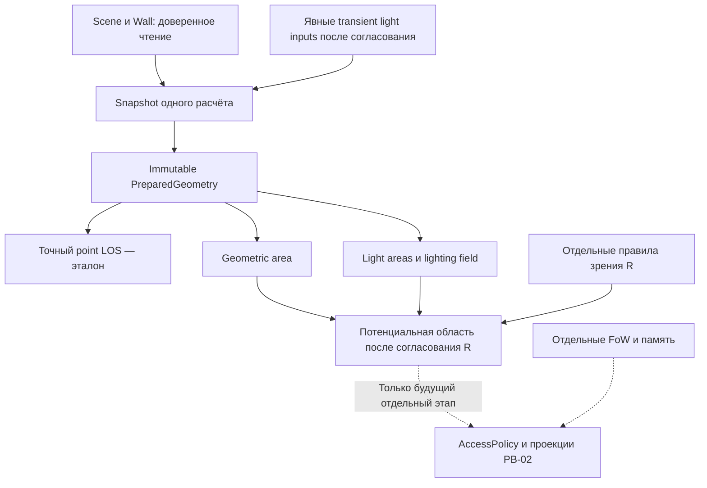

# PB-01d — проект области видимости и базового освещения

**Исторический архитектурный проект; D01/D02 согласованы владельцем после review
PR #34 (PASS WITH RISKS). D03–D09 затем согласованы только для изолированного
point-lighting ядра PB-01d-2. D10/D11 остаются OPEN.**

D01: точный `PreparedGeometry.point_sight()` — источник геометрической истины;
приближённый контур разрешён только для вычислений и экспериментов, не для
раскрытия объектов, авторизации или автоматического FoW. D02: начальный алгоритм —
событийный ray-casting без скрытого допуска или произвольного количества лучей.
Реализация и фактические ограничения описаны в
[PB-01d-1](PB01D_VISIBILITY_AREA.md). Ниже сохранены исходная база и предложения
по остальным решениям. Актуальный scope света и ограничения — в
[реализации Basic Lighting](PB01D_BASIC_LIGHTING.md); это не разрешение runtime-интеграции.
База: master `edcecbb10398730948102557705db429853c4b0d` после
[merge PB-01c](https://github.com/LunierVeil/Laterna-VTT/pull/33).
[Full CI master](https://github.com/LunierVeil/Laterna-VTT/actions/runs/42032379047)
успешен: backend/frontend, 38 Chromium cases и CI required.

Источники: [AGENTS](../AGENTS.md), [ARCHITECTURE](ARCHITECTURE.md),
[ROADMAP](ROADMAP.md), [BETA_DECISIONS](BETA_DECISIONS.md),
[правила PB-01](PB01_VISIBILITY_RULES.md), [реализация PB-01c](PB01C_PREPARED_SCENE_LOS.md).
LTR-DEC-001–008/G1–G6, окна W3, personal/shared vision и разведка не переутверждаются.

## 1. AS-IS на базе проекта и разрешённая граница

| Есть в коде | Чего это не означает |
| --- | --- |
| [point_sight / PreparedGeometry](../server/app/line_of_sight.py): точные Fraction-предикаты, консервативные float-фильтры, frozen snapshot | Нет visibility polygon, полигонального union, света или готовности массового расчёта |
| [scene_sight / scene_sights](../server/app/scene_sight.py): одна новая read-session и один JOIN Scene/Wall на вызов | Snapshot не live lease; нет источников света в согласованной модели и нет AccessPolicy |
| P9 для обычной двери: open пропускает, closed/locked блокируют независимо от blocks_sight; wall использует blocks_sight | Нет стеклянной двери; window/secret_door/invisible отклоняются, W3 остаётся OPEN |
| [Token](../server/app/models.py) хранит vision_range/emits_light; поля есть в to_dict и wire DTO | Эти числа не являются утверждёнными дальностью зрения/радиусом/яркостью света; handlers не задают полноценную модель света |
| PixiJS [stage](../web/src/widgets/scene-canvas/lib/stage.ts) располагает token node в data.x/data.y | Не добавлять автоматически половину клетки или менять сохранённые координаты; выбор точки «глаз/лампа» требует решения |
| Ручной fog, фильтрация защищённых объектов, noop и reconnect работают отдельно | Нет динамической разведки; копированный /uploads URL остаётся отдельным GAP PB-02 |

Сохраняем server-authoritative модель, движение, epsilon как стартовый тестовый
параметр, seq/cmd_id/base_seq и JSON/БД. На исходном этапе PR #34 — **только документ**.
Исходный проект требовал выбрать контракт точности до прототипа. Теперь D01/D02
согласованы в ограниченном scope выше; остальные правила не выбираются реализацией.

## 2. Главный численный вопрос: область не равна обычному polygon

Факт текущего ядра: блокируется не только пересечение центральной линии стены,
но и расстояние от луча до стены **≤ epsilon**. Для ненулевого отрезка это
эквивалентно непроходимой для луча замкнутой полосе с круглыми концами — «капсуле».
Это описание существующего предиката, а не новая игровая толщина стены.

Пример: стена (350,100)–(350,350). Луч из (100,100−epsilon/2) в
(600,100−epsilon/2) уже BLOCKED, хотя центральную линию стены не пересекает.
При отступе 2epsilon — CLEAR. Эти два случая фактически проверены на базовом коде.

Поэтому стандартный polygon видимости нулевых сегментов может расходиться с
PB-01a около концов/углов. Контуры капсул содержат дуги, а ограничение света
кругом — ещё одну дуговую границу. Один конечный polygon из прямых рёбер не
представит их точно. Универсальное «point-in-polygon == CLEAR» без отдельного
контракта точности **не предлагается**. Даже выбор contains/covers меняет ответ
на границе: касание непрозрачной границы по текущему правилу блокирует.

Рекомендация D01: точный point predicate остаётся истиной; контур первой версии
имеет явно обозначенный статус **приближённого вычислительного результата**.
Его нельзя применять для раскрытия объектов, автоматического FoW или как
сертифицированную маску пикселей. Не заявлять гарантированную внутреннюю/внешнюю
оценку, пока это отдельно не доказано. Для решения о конкретной точке использовать
PreparedGeometry.point_sight, а для света — дополнительно согласованную проверку
радиуса. Если владельцу нужна строгая согласованность всей непрерывной области,
сначала проектировать представление дуг/полуоткрытых границ и его алгоритм.

Epsilon LOS, допуск аппроксимации контура и разрешение будущего рендера — разные
величины. Не вводить скрыто новый «угол ±0.001», число лучей, pixel margin или
новый epsilon. Численные значения допуска контура и бюджета требуют согласования.

## 3. Visibility Area: алгоритм и альтернативы

Область рассматривается для **точки** наблюдателя, в px сцены, без D&D-дальности,
направления взгляда или радиуса токена. В пустой комнате это вся сцена; в коридоре
за поворотом точка скрыта стеной. Открытая дверь удаляет только своё препятствие,
не другую стену, наложенную на тот же проход.

Граница сцены ограничивает область допустимых целей, но **не добавляется как
обычная непрозрачная стена**: иначе наблюдатель в (0,0) ошибочно получит P6-D.
Выход за сцену остаётся невалидным входом. Персонажа/источник не сдвигать.
OBSERVER_ON_OBSTACLE возвращать явно с отсутствующей вычисленной областью,
а не как весь стол или неотличимый от нормальной темноты пустой polygon.

Обозначения: N исходных стен, K их пересечений, M число частей после разбиения,
R число направлений, V размер выхода. Сложности ниже — геометрические оценки;
стоимость длинной Fraction-арифметики и полигональных операций в них не включена.

| Подход | Стоимость | Сильные стороны | Ограничения / вывод |
| --- | --- | --- | --- |
| Равномерный веер лучей | O(RN) без индекса | Простой независимый диагностический baseline | Пропускает узкие проходы и детали между лучами; число лучей не даёт гарантии. Не основной алгоритм |
| Лучи по геометрическим событиям: концы/пересечения, видимые пределы слева/справа | O(MN) при линейном поиске ближайшего препятствия, без учёта подготовки событий | Прозрачный первый прототип, легко сравнивать конкретные лучи с эталоном | Нельзя брать произвольный float-сдвиг угла; нужны устойчивый порядок направлений и отдельная обработка капсул/дуг |
| Угловой sweep по планаризованным отрезкам | Подготовка O((N+K) log N), затем типично O(M log M + V) | Хорошая цель для сложных сцен, меньше повторных полных scans | Предполагает корректный arrangement и структуру активных препятствий; для капсул формулы/события сложнее. Не готовая реализация O(N log N) для любых сырых пересекающихся стен |
| Arrangement границ капсул с точными/сертифицированными предикатами | Зависит от пересечений дуг и представления чисел; квадратичный worst case возможен | Путь к строгому контракту всей области | Алгебраические координаты, касания дуг, boolean operations; существенно больший scope, не обещать в маленьком PR |
| Проверка сетки/растра | O(число проверяемых точек × стоимость LOS) | Удобный тестовый oracle на выбранных точках | Не непрерывная область, зависит от sampling. Не заменяет математический контракт |

Рекомендация D02: после D01 начать событийный ray-casting прототип **кандидатного
контура**, без пользовательского потребителя; sweep выбирать следующим шагом
только по benchmark. Держать равномерный sampling тестовым сравнением, не истиной.
Порядок направлений сравнивать по квадранту/точным произведениям или эквивалентным
устойчивым предикатам; обход atan2 с фиксированным delta не считается доказательством.
Для строгой капсульной границы план/объём требуется пересмотреть до реализации.

Пересекающиеся стены требуют событий в точках пересечения. Дубликаты, обратные
концы и коллинеарные перекрытия нормализуются только во вспомогательной структуре,
без изменения сохранений и исходного PreparedGeometry. Не округлять полученные
точные пересечения в новые авторитетные стены. Отдельно измерять K: N стен может
дать O(N²) пересечений и взрыв памяти. Нулевые стены игнорируются с прежней
диагностикой, короткие ненулевые не удаляются ради ускорения.

## 4. Basic Lighting: исходное предложение

D03–D09 согласованы владельцем для изолированной реализации PB-01d-2. Ниже
сохранён исторический эскиз PR #34, включая прежние OPEN; фактический API,
согласованные ограничения и тесты — в [Basic Lighting](PB01D_BASIC_LIGHTING.md).
D10/D11, runtime-source mapping, W3 и игровые правила этим не утверждаются.

Минимальный кандидат D03 — **бинарная освещённость**, без яркости, цвета, falloff,
отражений и автоматических D&D-правил. Один источник — явно заданная позиция и
радиус в px; эти параметры — предложение transient API, не новые persisted поля.
Обычный круговой источник предлагается первым; конусы/высота/направление не вводятся.
Все значения/defaults, включение источника, допустимость нулевого радиуса и
пределы нагрузки остаются OPEN. Нельзя включить свет автоматически из emits_light.

Формула ниже — **PROPOSED, требует утверждения, не реализована**:

- Область источника — геометрически достижимые из него точки внутри согласованного
  радиуса и границ сцены. Для point oracle после утверждения границы радиуса
  можно сравнивать квадрат расстояния с квадратом радиуса, не извлекая sqrt.
- Освещённость точки — окружающий свет **или** хотя бы один источник, до которого
  есть CLEAR и выполнена проверка радиуса. Пересечение источников не усиливает свет.
- Общий контур освещения — логическое объединение областей. Сначала можно хранить
  набор регионов/предикатов, а не немедленно строить огромный polygon union.

Комната с лампой освещена только до стен. Открытая дверь позволяет её свету
попасть в коридор в пределах радиуса; другая лампа может осветить его с другой
стороны. Перекрытие двух кругов в предложенной бинарной модели остаётся просто
освещённым, не становится «вдвое ярче». Это не выбор физической фотометрии.

Предложение D04 для ambient: рассмотреть только явно заданные состояния
«нет окружающего света» / «вся сцена освещена». Во втором варианте стены всё равно
ограничивают **обзор наблюдателя**, но ambient не ведёт себя как ещё одна лампа,
лучи которой идут из неизвестной точки. Альтернатива — уровни освещения, отдельно
согласуемые с правилами зрения. Ни default, ни enum в БД сейчас не утверждены.

Источники на карте и токене сводятся к одной transient-позиции **после** разрешения
якоря. Для токена предлагается использовать существующее положение его центра,
не менять координаты хранения; возможность смещения лампы — отдельный вопрос.
Автоматический выбор наблюдателей/источников по player ownership, shared vision
или признаку GM-only сюда не входит. Источник на непрозрачной стене должен дать
диагностическое состояние по P6-D; судьба всей lighting field при таком источнике
ещё OPEN. Не превращать ошибку в «освещено везде» или тайно перемещать источник.

## 5. Совместная модель без смешивания обязанностей

| Уровень | Вопрос | Что он не решает |
| --- | --- | --- |
| Геометрия G | Есть ли прямая видимость из точки? | Свет, D&D, доступ игрока |
| Освещение L | Какие точки освещены по выбранной модели? | Кто вправе получить объект/источник |
| Правила зрения R | Как наблюдатель воспринимает L: дальность, особенности системы? | Геометрию стен, права и память |
| FoW / explored | Что сейчас замаскировано и что было разведано? | Автоматическое раскрытие нынешних токенов из прошлого знания карты |
| AccessPolicy / projection | Какие данные/recipients разрешены сервером? | Подмену всех остальных уровней одним CLEAR |

Предлагаемая композиция: `Potential = G ∩ R(L, observer)`.
Только для отдельно утверждённого обычного зрения без специальных правил
можно взять `R(L)=L`. Это **не универсальная формула D&D-зрения**: darkvision,
зрения ГМ, дальности и личного/общего зрения не выбираем. До утверждения правил
возвращаем отдельные геометрический/световой результаты, не ложный финальный Visible.
Не создаём ради этого rules SDK: адаптер/чистая функция появится для реального
согласованного потребителя, в существующих границах игровых систем.

FoW и память не обновляются этими функциями. Формат сохранённой разведки,
объединение по партии, исключение своего токена и ручной override не переопределяются.
`Potential` означает физическую/игровую возможность восприятия, **не список объектов
для отправки**. Будущий PB-02 отдельно проверяет роль, кампанию, разрешённую сцену,
GM-only и media для каждого канала; знание URL или попадание в область не даёт права.

## 6. Внутренние API и данные — эскиз, не утверждённые сигнатуры

| Предлагаемая операция | Вход | Результат |
| --- | --- | --- |
| Подготовить вспомогательную area-структуру | Текущий immutable PreparedGeometry | Immutable события/границы и ссылка на тот же геометрический snapshot |
| Вычислить geometric_area | Явная точка observer, area-структура | Статус + кандидатный контур с quality/контрактом границ, либо отсутствие области при P6-D/ошибке |
| Вычислить light_area | Явные source position/radius и тот же snapshot | Регион источника, ограниченный сценой; отдельно статус и качество |
| Вычислить lighting_field | Tuple transient sources, явно выбранный ambient, snapshot | Логическое объединение регионов, без материализации union при отсутствии потребителя |
| Проверить конкретную точку | PreparedGeometry.point_sight; будущий light classifier после согласования модели | Точный геометрический статус / LIT, UNLIT или UNAVAILABLE; не bool(SightResult) |

Названия и поля минимальных transient records ещё проектные. Нужны позиция/радиус
источника и качество результата; не нужны DB IDs тайных объектов в контурах,
права внутри математического ядра, registry, plugin loader или новая шина событий.
PreparedGeometry сейчас скрывает `_segments`: не разносить обращения к приватным
полям по модулям. Рассмотреть один узкий readonly-доступ к opaque-сегментам для
area-подготовки, сохранив point_sight и исходные предикаты без изменений.

Предполагаемое размещение: существующий `line_of_sight.py` — point truth;
новые чистые `visibility_area.py` и `lighting.py` — вычисления; `scene_sight.py`
либо небольшой соседний orchestrator — получение согласованного входного snapshot.
Это не перестройка backend в новые слои и не перенос FSD/Zustand/PixiJS.
Новые геометрические библиотеки пока не выбираются. Если строгие дуги/union
не удастся безопасно реализовать текущими средствами, отдельно обосновать зависимость
и изменение scope, а не скрыто подключать Shapely/другую библиотеку.

Диаграмма показывает зависимости результата, а не разрешённый сейчас сетевой flow.
Пути к REST/WS, renderer и автоматической записи памяти в PB-01d отсутствуют.

## 7. Snapshot, обновления и отсутствие обязательной миграции

В первой реализации геометрия и light inputs живут только в памяти одного
вычисления. Не сохранять новый JSON, radii defaults или light registry в существующие
колонки. Наличие emits_light/vision_range не разрешает backfill или трактовку их
исторических значений. Реальные источники на карте/токенах подключать лишь после
утверждения mapping; до этого достаточно синтетических входов чистых функций.
Если понадобятся новые persisted данные — сначала соответствующий migration gate
DataHome/backup/Alembic из Beta-решений, отдельный план и разрешение.

| Изменение | Предлагаемая реакция следующего вычисления |
| --- | --- |
| Стена/дверь/размеры | Новый committed geometry snapshot; старые area/light результаты не объявляются свежими |
| Observer moved | Новый geometric_area; geometry может переиспользоваться только в том же явно ограниченном snapshot |
| Источник перемещён / изменён радиус | Пересчитать его регион и производную field; событие не меняет стен автоматически |
| Несколько источников | Все используют одну версию opaque-геометрии; не отдельный scene_sight-read для каждой лампы |
| Rollback / удаление / смена сцены | Не публиковать uncommitted результат; новый вызов получает нужную сцену или unavailable |
| Старые данные вне новых границ / неизвестный kind | Сохранить безопасный отказ PB-01c; не добавлять скрытый clipping/fallback CLEAR |

Глобальный кеш по scene_id/seq пока не вводится. Seq включает и негеометрические
события, а сторонняя запись в БД может его не менять; одного seq недостаточно
для нового межпроцессного кеша. При доказанной необходимости позже рассмотреть
immutable content-keyed подготовку и измерить цену проверки актуальности.

**Новая проблема согласованного чтения:** PB-01c читает Scene/Wall одним SELECT,
но будущие источники на токенах потребуют ещё данных. Несколько SELECT не становятся
автоматически одним snapshot только от использования AsyncSession: нужно отдельно
проверить фактическую read-transaction/isolation, особенно SQLite legacy transaction
mode. Нельзя смешать закрытую дверь из одной версии с позицией лампы из другой.
Избегать JOIN walls × sources с квадратичным размножением строк. Для первой чистой
версии caller передаёт уже согласованный bundle; серверный builder — отдельный
проверяемый шаг плана, без изменений WS/схемы/команд в этом документе.

## 8. OPEN-решения владельца

**D01/D02 — APPROVED** в указанном выше ограниченном scope PB-01d-1.
**D03–D09 — APPROVED только для изолированного PB-01d-2** по ограничениям
в Basic Lighting. **D10/D11 — OPEN / PROPOSED**, не утверждены merge документа.
Таблица сохраняет исходные варианты и рекомендации; они не расширяют разрешение.

| ID | Что решить / варианты | Рекомендация и цена выбора |
| --- | --- | --- |
| D01 | Строгая область, совпадающая с LOS во всех точках, или явно приближённый contour + exact point truth? | Начать с явно кандидатного контура и точных point-проверок, без использования контура для выдачи/маски. Для строгой области нужен более широкий контракт дуг/границ |
| D02 | Событийный ray-casting / sweep / библиотека arrangement? | Начать с событийного прототипа, измерить N/K; никаких фиксированных угловых сдвигов. При требовании strict D01 пересмотреть сложность до coding |
| D03 | Бинарная освещённость с union или уровни/аддитивность/falloff? | Бинарный union как минимальный старт; не моделирует dim/bright D&D, не расширять молча |
| D04 | Ambient: явное none/full или уровни? | Для первого чистого API явный none/full без default и persistence; это не готовое правило мирового освещения |
| D05 | Источник: точка/центр токена/смещение; радиус в px; что значит 0? | Явная конечная позиция, положительный radius в px без чтения старых полей. Центр токена — кандидат; disabled/нулевое значение и максимумы согласовать отдельно |
| D06 | Как связать существующие emits_light/vision_range с новой моделью? | Пока не связывать и не мигрировать. Нужен явный compatibility/mapping contract до подключения реальных полей |
| D07 | Единая opaque-геометрия для света/обзора; как влияют окна? | Переиспользовать одну геометрию обычных стен/дверей. W3 и её светопропускание остаются OPEN; неподдерживаемое отклонять |
| D08 | Источник на стене/невалидный источник: unavailable всей field или частичный результат? | Сначала явный unavailable без положительного результата; не перемещать и не игнорировать ошибку тайно. Порядок обработки нескольких источников согласовать |
| D09 | Какие правила зрения применяются к L? | До решения выдавать G/L раздельно. Кандидат «обычное зрение требует L» не равен D&D darkvision; персональное/общее зрение не выбирать |
| D10 | Точность контура, ограничения N/K/V/числа источников и бюджет работы? | Сначала измерить, затем согласовать числа. При исчерпании бюджета — явный incomplete/unavailable, никогда вся сцена/CLEAR; runtime offload не решает стоимость сам по себе |
| D11 | Как читать геометрию и источники одним согласованным контекстом? | Request-scoped bundle, доказанная read consistency и отсутствие глобального кеша. Реальный DB-source adapter только после D05/D06, без новой схемы |

P6-D, epsilon `1e-7 px` и текущий P9 сохраняются как принятые для изолированных
PB-01a/b/c направления с известными рисками; это не утверждение нового polygon,
света, W3 или поведения авторизации. При необходимости изменить существующие
пограничные правила требуется отдельное решение, а не подгонка oracle.

## 9. План реализации: три небольших PR после согласования

| PR | Логические коммиты и результат | Критерии завершения |
| --- | --- | --- |
| 01d-1 — чистая Visibility Area | 1) Контракт D01/D02, аналитические fixtures и oracle. 2) Событийная area-подготовка/контур с явным quality. 3) Границы/пересечения/benchmark и docs | Ни одного изменения point truth; P6-D/unknown корректны; статус приближения не теряется. Без потребителя и разрешения раскрытия |
| 01d-2 — Basic Lighting | 1) Утверждённые transient inputs D03–D08 и point-light oracle. 2) Регионы источников/union/ambient. 3) Перекрытия, движение и нагрузки | Только согласованная модель, отдельные G/L; нет чтения emits_light по догадке, persistence, UI и FoW |
| 01d-3 — согласованный внутренний контекст | 1) Минимальный builder одной версии входов и D11. 2) Lifecycle/rollback/concurrency, отдельная композиция после D09. 3) Hardening, budgets и итоговый benchmark | Без публичных API, новых payload и AccessPolicy. Если реальный source mapping всё ещё OPEN — серверный адаптер источников не реализуется |

Если D01 требует строгого curved arrangement или D03 вводит уровни/правила,
не обещать этот же объём в трёх PR: сначала показать новый план и согласовать
разделение. Ни один PR из таблицы не начинается автоматически после этого docs PR.
После каждого логического коммита — профильные проверки/Fast CI точного SHA;
готовый PR — независимое review, актуальный Full CI/test merge и строгий gate.

## 10. Тесты и benchmark будущей реализации

Ниже **план**, эти новые алгоритмы и замеры ещё не выполнены.

| Группа | Проверки |
| --- | --- |
| Аналитические области | Пустой прямоугольник; комната/коридор; open/closed/locked; observer в (0,0) без стены |
| Границы | Касание конца/угла, P6-D включая A=B, цели на границе, ε/2, ε, 2ε, почти параллельные и узкие проходы |
| Arrangement | X/T-пересечения, общая вершина, дубли, обратные концы, коллинеарное наложение, нулевые и короткие сегменты; permutation invariance |
| Precision | Дробные координаты, subnormal, около 0/8192, пересечения с нецелыми рациональными координатами; не менять epsilon ради результата |
| Area против oracle | На известных аналитических и детерминированных случайных точках сравнить классификацию с исходным PB-01a и PB-01b/c; пограничные точки тестировать отдельно. Сетка sampling не доказывает точность всей области |
| Свет после утверждения | Радиус до/на/после границы, лампа за дверью/у стены/на границе сцены, два и много перекрытий, ambient, отсутствие света; invalid не превращается в LIT |
| Совместность | Видимая геометрически, но не освещённая точка; освещённая, но закрытая от observer; G и L сами не становятся AccessPolicy |
| Lifecycle | Перемещение источника/observer, изменение двери/радиуса, rollback, удаление/смена сцены, старый bundle, два engine, согласованность multi-read и snapshot lifetime |
| Совместимость | Не меняются модели/JSON/seq/noop/REST/WS/reconnect; legacy out-of-bounds остаётся явной ошибкой; источники/окна не активируются из старых чисел |
| Приватность | Нет новых routes и outbound geometry/diagnostics. Будущий PB-02 отдельно проверяет копированные ссылки, hidden geometry и recipients; численный CLEAR не заменяет эти тесты |

Benchmark-матрица как предложение нагрузки, **не утверждённые лимиты**:
N = 200/2000/10000 стен; источники = 0/1/8/32; observers = 1/4/8. Отдельно
несколько тысяч пересечений K, редкие/частые изменения двери и движущиеся источники.
Сценарии: свободный коридор, лабиринт, близкие почти касающиеся стены, перекрытия
света и плохой для отсечения случай. Не запускать сразу всю декартову матрицу
без оценки длительности; extended workload должен быть явно выбран и завершён.

Разделять время/память подготовки, один area, один источник, field/union,
композицию, повторное использование и полное пересоздание; для request builder
отдельно SQL/ORM/transaction latency. Сохранять raw samples, окружение, seed,
warmup и метод p95; публиковать замедления и cases с отказом по бюджету. Не выдавать
набор из пяти samples за надёжную хвостовую статистику или GPU FPS.

Исходный [benchmark PB-01c](../scripts/benchmark_prepared_los.py) показывает,
почему это важно: на 24 базовых стенах 10000 запросов возле препятствий заняли
примерно 14 секунд, а refresh при каждом изменении двери был медленнее PB-01b.
Это историческое измерение на базе PB-01c, **не замер нового polygon/света**.
Нельзя обернуть старый точный scan в тысячи лучей и объявить массовый свет готовым.

Unit tests — только синтетические данные. Перед будущим ready PR нужны полный
backend, frontend unit, typecheck/build, structure, diff-check и Full CI с
существующими Chromium группами 9/8/5/16 и CI required актуального test merge.
Новые browser cases/counts добавлять согласованно при реальном потребителе;
не менять manifest ради формального тестирования невидимого прототипа.

## 11. Отдельные риски

Это риски будущей интеграции, не заявление о новых обнаруженных утечках AS-IS.

| Безопасность | Почему опасно | Ограничение |
| --- | --- | --- |
| Приближённый contour даёт ложную видимость | Пропущенный угол/щель раскрывает объект | Point oracle и отдельный PB-02; contour не authority |
| Сами polygon/light shapes раскрывают секрет | Можно восстановить стены, дверь или скрытый источник без его ID | Не отправлять клиенту; согласовать projection и source secrecy позднее |
| Смешаны версии двери/источника или старый кеш | Неверный свет/обзор после commit | Один доказанно согласованный bundle, без долгоживущего кеша |
| CLEAR смешан с правами/разведкой | GM-only или старые видимые токены раскрываются неправомерно | Пять раздельных уровней; существующие права/FoW не изменяются |
| Ошибка/лимит преобразован в весь стол | Fail-open при тяжёлой или испорченной карте | Явный статус без положительного результата, без fallback CLEAR |

| Производительность | Риск | Что проверять |
| --- | --- | --- |
| N² пересечений / N² лучей | Взрыв времени/памяти до построения области | K/M/V отдельно, адверсарные сцены, budgets после измерений |
| Fraction + число источников/наблюдателей | Стоимость умножается, event loop простаивает | Крупные пачки не подключать к сетевому loop; доказать ускорение/планирование до интеграции |
| Polygon union и дуги | Выход может стать сложнее входа, библиотеки меняют precision | Логический union сначала; материализацию и зависимость обосновать |
| Частые двери/движение | Подготовка не окупается, очередь устаревших jobs | Измерить refresh, отмену/объединение запросов; не применять поздний результат к новому bundle |
| SQL и многократное получение одной сцены | IO/большие JOIN скрывают выигрыш математики | Один контекст на расчёт; без декартова JOIN; отдельно измерить чтение |

D01/D02 согласованы для приближённого контура; это не делает конечный polygon
эквивалентным точному LOS. D03–D09 задают минимальную модель света/зрения;
D10/D11 — условия безопасной будущей интеграции. Этот документ не запускает ни
одну из этих реализаций, не меняет ROADMAP и не разрешает Ready/merge PB-01d.
