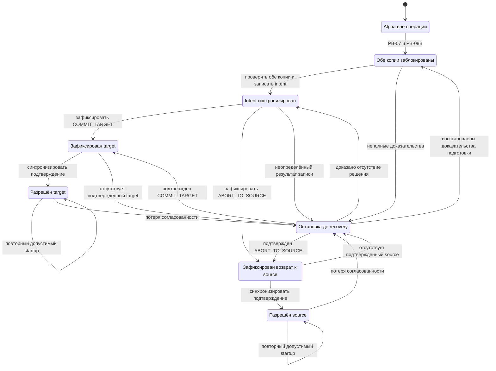

# PB‑08C — долговечное переключение DataHome

Статус · **проект для независимого архитектурного review**. База
`d55872dd728d48a570107bf4953e81fd0f4d2773`, включая PB‑08B. Родительская
задача [#49](https://github.com/LunierVeil/Laterna-VTT/issues/49).
Проект описывает предлагаемый контракт. Приёмка дизайна предшествует
реализации. Последующие тесты в этом документе запланированы.

## Цель и действующая граница

Оператор останавливает Alpha, получает проверенный backup и подготовленный
DataHome средствами PB‑07 и PB‑08B. После явного решения обновлённый launcher
поднимает выбранный существующий стол. После сбоя recovery может продолжить
то же решение либо явно отменить попытку до фиксации. В каждый момент право
записи имеет максимум один DataHome. Публикация target, успешный Alembic
stamp и сообщение CLI о подготовке сохраняют оба блокирующих маркера.

PB‑07 уже даёт snapshot, receipt и source marker. PB‑08B публикует target
с отдельным маркером после сверки строк всех прикладных таблиц, ключа и медиа.
Новый слой повторно использует эти проверки, PB‑06 Verify/Restore и PB‑05
storage locks. Формат backup manifest v1, граф Alembic, SQLite DDL, REST/WS
контракты и политика retention остаются действующими. Автоматические
копии не обслуживают журнал cutover и не удаляют pre-upgrade snapshot.
[Подготовка Alpha](PB08_ALEMBIC.md#подготовка-копии-alpha-на-linux) ·
[Backup/Restore](PB06_BACKUP.md) · [PB‑07](PB07_AUTOMATIC_BACKUP.md) ·
[Recovery PB‑07](PB07_RECOVERY_RUNBOOK.md)

Срез Linux использует остановленную файловую SQLite в одном DataHome,
точную Alpha и проверяемую целевую ревизию. Действуют требования PB‑07/08B
к rollback-формату, отсутствию sidecars перед подготовкой, файловому
ключу, свободному месту, владельцу каталогов, ext4/XFS/Btrfs и mount options.
Проверки выполняются на каждом mount, участвующем в записи, включая каталог
журнала. Внешний ключ, per-file overrides, PostgreSQL, in-memory, сетевые,
съёмные и неподтверждённые тома вне поддерживаемого upgrade. Независимые
локальные mount для source и target допустимы только после испытания именно
этой топологии, иначе допуск закрыт. Обычные backup и startup вне управляемого
профиля сохраняют свои контракты. [Storage preflight](../server/app/storage_preflight.py) ·
[Gate PB‑07](../server/app/pre_upgrade.py)

## Доступ старой версии

Историческая Alpha читает `DATABASE_URL` и по умолчанию открывает
`./lanterna.db` относительно рабочего каталога. Uploads и ключ по умолчанию
берутся из дерева сервера. Новый marker ей неизвестен, а переименование
исходника без защиты старого пути может привести к созданию пустой SQLite.
Простой запрет в новом launcher также обходится прямым запуском старого
Python или старой упаковки. [Исторический config Alpha](https://github.com/LunierVeil/Laterna-VTT/blob/4d2797d4589d42c11ac7e6fb6b13d338d011190f/server/app/config.py)

**Предлагаемый обязательный допуск.** До подготовки оператор или
доверенный установщик останавливает старые сервисы, автозапуск и внешние
SQLite-клиенты. Он закрывает им доступ к исходному и будущему дереву данных
на уровне ОС и проверяет отсутствие прежних открытых дескрипторов, включая
процессы с текущим каталогом внутри данных. На Linux кандидат — отдельные
непривилегированные identities для исторического и нового runtime, общий
доверенный оператор обслуживания и административно защищённые предки путей.
Для новой попытки обслуживающий UID должен одновременно удовлетворять
требованиям PB‑08B по владению source и родителем target. Установщик настраивает
это до snapshot, с сохранением байтов payload и журналом изменений прав.
Runtime получает только требуемые ему права. У существующей prepared копии
смена владельца файлов может нарушить доказательства receipt. Её допуск
требует изоляции без нарушения этих доказательств, иначе такая копия
остаётся fenced до специально утверждённой процедуры. Изоляция должна
действовать после перезагрузки до запуска сервисов; недоступный якорь
проверки закрывает старт. Запуск исторического кода от нового runtime или обслуживающего
пользователя исключается настройкой сервиса и правами на исполняемое дерево.
Старым UID запрещены traversal к сохранённому Alpha, обоим актуальным
DataHome и журналу, а также создание SQLite/ключа/uploads по прежним путям.
Вариант с одним UID допускается к обсуждению только при эквивалентной
изоляции mount namespace или политики ОС, в том числе для ручного запуска.
Администратор, умышленно снимающий права, и копии на иных установках вне модели.

Проверяются реальные исторические entrypoints и эффективные UID, CWD,
`DATABASE_URL`, `UPLOAD_DIR`, `GM_KEY_FILE`, сервисы и mount aliases.
Тест использует старый launcher и прямой исторический backend в изоляции.
При допустимой установке оба завершаются до доступа к данным и до создания
пустого стола по старому пути. Отсутствие проверяемой изоляции закрывает
cutover, включая уже подготовленные PB‑08B копии. Изоляция сохраняется
после отмены. Возврат к source выполняется обновлённым runtime, поэтому
открывать старому UID данные снова не требуется. До принятия проекта
операции с пользовательскими путями, ACL и сервисами не выполняются.

## Идентичность и журнал

- **Регистрация установки.** Явно настроенный доверенный каталог управления
  держит постоянный `installation_id`, заранее созданный lock и каталог
  операции по `attempt_id` PB‑07. Runtime может захватывать существующий
  lock, при этом прав на его замену или запись журнала у runtime нет. Каталог вне source, target, backup, ZIP и меняемого
  дерева кода. Читается из защищённой конфигурации установки. Привязки в
  каждом DataHome содержат только версию, installation ID и attempt ID.
  Совпадение привязок проверяется с обеих сторон защищённой конфигурации.
  Подмена пути к журналу через аргумент или окружение не даёт допуска.
  В версии 1 у регистрации одно поколение операции. Потеря его указателя
  блокирует запуск, выбор другого поколения требует отдельного протокола.
- **Данные.** Для source и target хранятся роль, абсолютный канонический
  путь, постоянная идентичность FS/тома и подтома, идентичность DataHome
  и родителя, отпечатки первоначальных маркеров, ожидаемые каталоги/ревизии,
  хеши receipt и manifest. Для Linux кандидат на файловую идентичность —
  UUID ФС, ID подтома Btrfs при наличии, inode каталога и привязка операции.
  `st_dev` и mount ID сверяются при каждом открытии, их численное значение
  после перезагрузки может измениться. Допустимый способ получить и проверить
  постоянные идентификаторы на всех трёх ФС подлежит отдельной проверке.
  Чтение по дескрипторам с запретом symlink, hardlink и неподдерживаемых
  mount aliases, проверка owner/mode и повторное сравнение дескриптора с
  записью каталога закрывают подмену в принятой модели доверия.
- **Начальные доказательства.** Source marker должен побайтово совпадать с
  receipt. Между receipt, backup manifest и target marker сверяются
  идентификатор попытки, хеш manifest и обе ревизии. До решения заново
  проходят Verify, точный каталог и сверка source/target с snapshot по
  правилам PB‑08B. DB backup сравнивается по данным SQLite, поскольку
  побайтовый хеш снимка не является хешем оригинальной SQLite. Сравниваются
  также inventory и хеши ключа/медиа. Для начала контроля записываются
  inventory и хеши обеих копий, включая фактические байты SQLite.
  По окончании preflight повторно проверяются identity, маркеры и отсутствие
  изменившихся файлов. После допуска новые допустимые записи изменяют
  хеши данных, поэтому startup сверяет их identity и актуальную совместимость,
  а не требует равенства исходному снимку. Значения ключей, данные игроков
  и полные inventory не выводятся в диагностику.
- **Записи.** Неизменяемый `intent.json` связывает доказательства, сроки и
  обе роли. Один неизменяемый `decision.json` по тому же attempt ID
  содержит `COMMIT_TARGET` либо `ABORT_TO_SOURCE` и хеш intent. Время записи
  служит диагностике, приоритет по времени не вычисляется. Перед первым
  допуском пишется неизменяемое подтверждение активации на стороне выбранного
  тома в отдельном защищённом каталоге, вне изменяемого payload. Оно содержит
  точный хеш решения и роль. Подтверждение никогда не заменяет решение.
  Парсер версионирован и ограничен по размеру, отклоняет неизвестные поля
  формата, повторы ключей, дубликаты записей и несовместимые роли; распознанный
  префикс повреждённой записи не является решением. Журнал и подтверждение
  защищены владельцем/правами. Хеши обнаруживают повреждения и несогласованность
  в рамках модели доверия.

## Автомат и фиксация

Диаграмма показывает наблюдаемые состояния. `Hold` вычисляется при
проверке. Он не перезаписывает журнал и не обнуляет последнее решение.

| Переход | Условие и долговечная запись | Допуск к приложению |
| --- | --- | --- |
| Alpha → подготовка | Изоляция старого runtime. Штатный PB‑07 фиксирует receipt и source marker. PB‑08B публикует fenced target по правилам no-replace и fsync его родителя. | С момента source marker обе стороны закрыты. |
| Подготовка → intent | Под блокировками сверить обе копии, backup, маркеры и FS. Повторно подтвердить долговечную публикацию target. Зафиксировать привязки и якорь подтверждения на их томах, затем записать и синхронизировать intent. | Закрыто. Старый prepared target принимается только после полного повторного допуска. |
| Intent → `COMMIT_TARGET` | Явное действие оператора для installation/attempt ID. Повторная проверка. Опубликовать один терминальный файл по правилам ниже. | До барьера и подтверждения закрыто. Source остаётся заблокирован. |
| Intent → `ABORT_TO_SOURCE` | Явная отмена. Доступны исходные идентичности и оба якоря. Доказаны отсутствие решения, отсутствие подтверждения активации и неизменность подготовленного payload. Записать терминальный abort тем же способом. | До барьера и подтверждения закрыто. Затем допускается только source через новый runtime. |
| Терминальное решение → допуск | Долговечность решения подтверждена, привязки и маркеры совпадают, проверен существующий выбранный DataHome. Опубликовать и синхронизировать подтверждение на выбранном томе до выдачи права на запись. | Только выбранная роль. При ошибке тот же переход может завершить recovery. |
| Повтор команды или старта | Тот же ID и те же параметры читают текущее состояние. Повтор зафиксированного решения проверяет его без повторной публикации target. Противоположное решение отклоняется. | Та же выбранная роль. Менять профили или запускать другой DataHome автоматически нельзя. |
| Любое состояние → Hold | Отсутствие ожидаемых записей либо конфликт, EIO, некорректный mount или identity. Закрыть допуск. | Нет старта и автоматического выбора. Recovery повторно читает и проверяет все якоря. |

**Durable commit point** — успешный `fsync` каталога журнала после
публикации `decision.json` с `COMMIT_TARGET`. Перед публикацией полностью
записать временный файл в том же каталоге, выполнить `fsync` файла,
сверить его, затем `renameat2(RENAME_NOREPLACE)`. Для каждой новой
привязки, записи и подтверждения применить тот же порядок. Все вновь
созданные каталоги синхронизируются снизу вверх до уже синхронизированного
родителя. Барьеры для данных target, snapshot, source marker и изоляции
старого runtime должны пройти **до** решения. На нескольких томах это
упорядоченные барьеры, каждый на своём томе. Публикации через rename между
mount, copy/delete, замена существующего terminal файла и удаление записей
по тайм-ауту запрещены. [Linux fsync](https://man7.org/linux/man-pages/man2/fsync.2.html) ·
[Linux renameat2](https://www.man7.org/linux/man-pages/man2/renameat2.2.html)

Если публикация видна, но исход `fsync` неизвестен, recovery под теми же
блокировками перечитывает файл и **повторно синхронизирует его и каталог**.
Никакой startup не использует видимость имени как подтверждение
долговечности. При валидном видимом commit recovery доводит его до
надёжного состояния. Отмена допустима после перезапуска только при
подтверждённо доступных исходных mount, полном intent и привязках,
отсутствии terminal записи и обоих подтверждений, целых обеих копиях.
Пропавший журнал при имеющемся подтверждении активации — Hold, а не
возврат в Pending. Потеря обоих независимых носителей доказательств или
внешний откат их снимков требует ручного разбора. История решения в этом
случае считается неизвестной, автоматического переиспользования попытки нет.

## Launcher, блокировки и recovery

1. Управляемый launcher сначала загружает защищённую регистрацию, затем
   разрешает путь только из согласованного terminal решения. Путь передаётся
   backend до импорта конфигурации в режиме `LANTERNA_REQUIRE_EXISTING=1`.
   Окружение конфигурирует процесс, право запуска проверяется отдельно.
   При отсутствии данных launcher не предлагает подготовить новый стол.
   Для обычной неуправляемой установки сохраняются прежние правила
   разрешения путей. Установка, зарегистрированная для cutover, знает
   об этом из защищённой конфигурации снаружи DataHome. Пропажа локального
   marker или binding не переводит её в неуправляемый режим. [Linux launcher](../laterna.sh) ·
   [Разрешение DataHome](../server/app/data_home.py)
2. В backend startup проверяет то же состояние перед открытием SQLite
   на запись, seed, загрузкой ключа, планировщиком backup и открытием
   listen socket. Маркеры source и target остаются. Опознанная привязка
   плюс валидный terminal и подтверждение дают разрешение только
   соответствующей роли. Отсутствие любого ожидаемого файла останавливает
   даже прямой запуск нового backend на зарегистрированном пути. Подтверждение
   создаёт только офлайн-owner. Backend перед каждым допуском повторяет
   `fsync` файла и родительского каталога решения и подтверждения по
   read-only дескрипторам под lock операции. Это исключает выдачу допуска
   по имени, ставшему видимым после сбоя, но ещё не закреплённому на носителе.
   Невозможность повторить барьеры на поддерживаемой конфигурации закрывает
   startup. Старый PB‑08B backend без этой проверки видит
   marker и блокируется. Прямой запуск, режимы LAN/tunnel/Porthole,
   `gm` и команды backup/create должны выбирать тот же дом. Managed
   preflight проходит до публикации туннеля или вывода ключа. Backup/create
   использует существующий control endpoint владельца, поэтому клиент
   команды не пытается перехватить его пожизненный storage lock.
   `verify` и `restore` работают с явными копиями по PB‑06. Restore в
   зарегистрированный путь отклоняется, а restore в отдельный каталог
   сам по себе не меняет выбор launcher. [Lifecycle FastAPI](../server/app/main.py)
3. Порядок захвата: lock регистрации/операции, затем участвующие PB‑05
   locks, для двух копий **target → source**, внутри DataHome — существующий
   порядок путей. Offline-подготовка сохраняет порядок PB‑08B. При попытке
   поддержать произвольные несколько профилей один DataHome может
   принадлежать только одной операции, коллизия блокируется.
   Все захваты nonblocking. Конкурентный процесс получает занятость и
   выходит без изменений. Launcher освобождает свой read/preflight lock
   перед запуском дочернего процесса. Backend заново берёт lock операции и
   lock выбранного storage, повторяет проверку и только затем освобождает
   lock операции. PB‑05 locks удерживаются на всём lifespan, до завершения
   фоновых workers. Внутренний Restore сохраняет уже переданный ему lock.
   [Storage locks](../server/app/storage_lock.py) · [Путь подготовки](../server/app/alpha_upgrade.py)
4. **До фиксации.** `status` показывает найденные anchors/markers и статус
   проверки без записи. `recover` по явному ID завершает только
   доказуемый переход по таблице. При неполной подготовке PB‑08B сохраняет
   source, snapshot и staging. При утрате target до решения обе копии
   остаются закрыты, пока проверяемая identity не восстановлена. Оператор
   может получить проверенную отдельную копию через PB‑06 для диагностики.
   Отмена начатой операции с отсутствующим target требует отдельной
   процедуры подтверждения истории, а не вывода по отсутствию каталога.
   После `ABORT_TO_SOURCE` source вновь пригоден для записи через управляемый
   startup. Старый snapshot и target относятся к закрытой попытке.
   Новый upgrade требует нового snapshot и нового поколения регистрации.
   Протокол смены поколения после abort требует согласования отдельно.
5. **После фиксации.** Recovery достраивает подтверждение или повторяет
   startup того же target. Если сервис уже принимал записи, приоритет у
   существующего target и его новых данных. При отсутствии target, повреждении
   или смене identity отключить доступ, сохранить живую SQLite с sidecars,
   медиа и ключ без хирургии журналов, искать исходный том/идентичность или
   верифицированную копию target после последней подтверждённой записи.
   PB‑06 Restore допускается в отдельный изолированный путь для проверки.
   Замена привязки на другой том или файл и признание старой копии новым
   активным столом требуют отдельного утверждённого recovery. Пока полнота
   нового состояния не доказана, остановка предпочтительнее потери данных.
   При обнаружении SQLite sidecar действует существующий отказ startup.
   Для диагностики оператор копирует полный остановленный набор SQLite и
   sidecars под locks в изолированное место. Попытка штатного SQLite recovery
   и проверка на этой копии требуют отдельного допуска. Механизм переноса
   восстановленного состояния в активную identity требует согласования.
   Исходный Alpha и его backup остаются для расследования и архива.

## Windows design gate

Штатное поведение сохраняет запрет PB‑07 до любых upgrade-записей.
Кандидат для отдельного review — **локальный фиксированный NTFS-том**,
защищённый каталог до начала попытки и выделенная identity службы с DACL,
исключающей запуск старого runtime на обеих копиях. Проверять по
дескриптору volume serial/file ID, атрибуты reparse points и действительные
ACL. Profile может хранить состояние в отдельном защищённом каталоге
профиля установки, если права владельца legacy не позволяют менять этот
якорь. Portable требует закреплённого локального NTFS-тома, защищённого
якоря отдельно от заменяемого ZIP и тех же ограничений на legacy runtime.
Текущее меню Profile/Portable и `-RestoredDataHome` не могут выдавать
допуск. Съёмное использование, копирование Portable-каталога на другой
том, junction, сетевой путь, FAT/exFAT и переход на иной тип ФС требуют
другого протокола. [Windows launcher](../windows/laterna.ps1) ·
[File ID](https://learn.microsoft.com/windows/win32/api/winbase/ns-winbase-file_id_info) ·
[Reparse points](https://learn.microsoft.com/en-us/windows/win32/fileio/reparse-point-operations)

Для эксперимента предлагаются заранее созданный файл решения с двухслотовой
записью (версия, номер, хеш предыдущей записи, CRC/хеш тела, operation ID) и
отдельный якорь подтверждения на томе выбранного дома. Из двух слотов
принимается только единственная непротиворечивая цепочка. Повреждение
последнего возможного terminal слота трактуется как неопределённость,
ранний intent не даёт права отменить даже при читаемом предыдущем слоте.
Launcher recovery подтверждает данные, volume/file ID, журнал, маркеры и
изоляцию перед выбором роли. `FlushFileBuffers` конкретного файла проверяется
как часть эксперимента. Сам по себе flush не доказывает фиксацию каталога,
прав и порядка нескольких записей. Требуются экспериментальное
подтверждение публикации каталога и записи решения, анализ доступных
барьеров и явное подтверждение выбранной версии Windows и конфигурации VM.
[FlushFileBuffers](https://learn.microsoft.com/en-us/windows/win32/api/fileapi/nf-fileapi-flushfilebuffers) ·
[MoveFileExW](https://learn.microsoft.com/en-us/windows/win32/api/winbase/nf-winbase-movefileexw) ·
[Windows ZIP smoke](../scripts/windows-datahome-smoke.py)

## Матрица приёмки и отказов

Все новые прогоны используют синтетические временные DataHome. Профиль
включает Runtime, CLI и launcher; отсутствие listen/seed/GM key write
проверяется наблюдаемыми эффектами. Существующие тесты PB‑07 и PB‑08B
образуют характеристику подготовки. [Alpha upgrade](../server/tests/test_alpha_upgrade.py) ·
[Pre-upgrade](../server/tests/test_pre_upgrade.py) · [Restore](../server/tests/test_instance_restore.py) ·
[Locks](../server/tests/test_storage_lock.py) · [Schema](../server/tests/test_schema_migrations.py)

| Точка инъекции и сценарий | Запланированная проверка |
| --- | --- |
| Подготовка, публикация и запись intent | Kill до/после source marker, в staging, до/после no-replace rename target, после первой привязки, до/после fsync intent. Ни один неподтверждённый DataHome не слушает порт; повторная диагностика сохраняет байты источника и доказательства. |
| Терминальная запись до commit point | Kill до записи, после записи временного файла, после flush файла, сразу после rename и до fsync родителя. Отсутствующая durable запись допускает только повторное явное решение при целых доказательствах. Валидная опубликованная запись после повторной синхронизации сохраняет решение. |
| Авария после commit point | Kill после fsync решающего каталога, до подтверждения, после его публикации, до listen, после первой подтверждённой записи в target. Recovery завершает только живой target и сохраняет новые данные. |
| Отмена | Abort до commit, kill в каждом окне его записи, повтор abort и попытка commit после него. Только source получает допуск; target остаётся fenced. Commit, за которым оператор вызывает abort, сохраняет выбор target. |
| Повреждение и конфликт | Усечь или заменить intent/decision, продублировать ключ, подменить маркеры или хеш receipt, удалить решение при сохранившемся подтверждении. Hold, обе копии защищены, автоматического fallback/seed нет. |
| Missing target или неверная identity | Отключить mount, удалить имя цели, подставить другой root, inode, symlink/reparse, другую attempt ID. Без записи. После возврата исходного тома recover продолжает прежнее решение. |
| Конкурентный процесс | Параллельные prepare, commit, abort, startup, Restore на тот же путь. Не больше одного storage owner и terminal решения. Попытка старого бинарника от его UID отклоняется ОС и не создаёт новый стол. |
| I/O и publish | EIO/ENOSPC при записи и каждом fsync каталога, конфликт назначения, замена родителя, ошибки разрешений. Проверить marker, отсутствие запуска и сохранение чужого каталога; валидный видимый terminal требует повторной синхронизации перед допуском. |
| Каталог и содержимое | Валидный manifest с неизвестной Alembic revision/drift, неверные FK, hot journal, WAL-format и несогласованные хеши. Данные не изменяются. Успешный цикл сохраняет UUID, пользователей и входы, ключ ГМ, сцены, листы, медиа, seq и связи. Проверить чтение через API и штатный startup без seed. |
| После новых данных | Сделать запись через API, сохранить медиа, оборвать процесс, возобновить тот же target. Проверить обе записи и сохранность исходника. При недоступном target исключить автостарт Alpha и автоматическое восстановление более старой копии. |
| Перезапуск | Повторить managed launcher, прямой backend с путями source/target, override, LAN/tunnel/Porthole и команды gm/backup. Результат определяется проверенным решением. Неверная привязка или отсутствующая запись не создаёт DataHome. |

**Process crash и power loss.** Инъекции исключений и kill процессов
проверяют последовательность и recovery при работающем ядре. Для заявлений
о долговечности отдельно выполнить abrupt power-off/restart VM с
настроенным реальным cache/barrier поведением, затем физическое
отключение для заявляемого аппаратного профиля. Для Linux отдельно
записывать kernel, FS, mount options, накопитель и параметры VM, покрыть
ext4/XFS/Btrfs и отдельные тома, где они заявляются. Для кандидата Windows
испытать одну утверждаемую версию Windows и NTFS, Profile и Portable,
отдельно process kill и отключение VM между flush файла, публикацией
каталога, commit и первой записью. В каждом повторе фиксировать наблюдаемое
решение после рестарта, допустимую роль, байты и inventory исходника,
целостность результата и новые данные target. Отсутствие этой приёмки
оставляет Windows upgrade закрытым. Успех обычного Windows ZIP smoke
доказывает только его действующие сценарии.

## Готовность первого результата

Для документационного среза приёмка включает читаемую диаграмму и
однозначные переходы, отличимые процессные и power-loss тесты, риски
исторического launcher и отдельный Windows design gate. Публикация —
документационный Draft PR в отдельной ветке с точным SHA для review.
Граница среза проходит до экспериментального изменения startup, cutover,
fences или пользовательских данных. Очередь интеграции PR #99 сохраняется.

## План и вопросы review

1. Утвердить формат регистрации и долговременной identity, отдельную
   схему доверенного запуска и proof изоляции исторической Alpha на Linux.
   Проверить возможность безопасного допуска уже подготовленных сеансов.
2. Реализовать read-only классификатор и отдельные офлайн-команды
   status/commit/abort/recover. Подключить существующие проверки PB‑07/08B,
   добавить тесты сбоев каждого барьера до любых изменений launcher.
3. Включить общий provider DataHome для launcher и стартовых команд и
   backend-проверку под locks до RW. Покрыть shell/CLI, subprocess и
   полный запуск с оригиналом и копией на синтетических fixtures.
4. Проверить протокол на Linux VM/ФС и обновить runbook. Отдельно
   согласовать смену поколения после abort, recovery при утрате хранения
   и поддержку split mounts с доказательствами. Ручная приёмка на
   пользовательском DataHome подлежит отдельному разрешению.
5. Отдельное решение по Windows включает защищённую identity для
   Profile/Portable, выбор durability primitive и воспроизводимые
   VM-restart тесты. До его приёмки Windows upgrade остаётся закрытым.

На review вынесены обязательность доверенного установщика/раздельных
runtime identities, постоянные якоря журнала и подтверждения, отсутствие
неявного возврата к Alpha после commit, параметры испытаний долговечности
и допустимый ручной путь при недоступности одного тома. Спорные решения
требуют согласования до реализации. Issue [#49](https://github.com/LunierVeil/Laterna-VTT/issues/49)
остаётся открыт до приёмки всего жизненного цикла. Issue
[#97](https://github.com/LunierVeil/Laterna-VTT/issues/97) относится к
отдельной диагностике SQLite/WebSocket.
