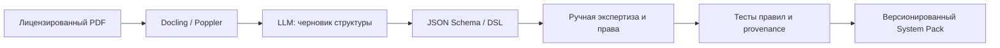
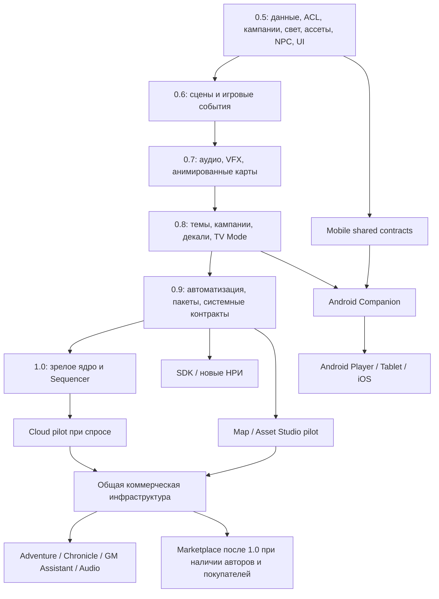

# Laterna VTT — обновлённая дорожная карта

> **Статус: DRAFT / рабочая копия для Codex, без внутренних разделов 11–13**  
> **Дата:** 27.11.2026 · редакция 2 (scope review)  
> **База сверки:** `LunierVeil/Laterna-VTT`, master `ae098facae40d0b7e346d546909a7b26b072f4b0`.  
> **Горизонт:** Beta 0.5 → Release 1.0 → Laterna Platform & Ecosystem.

Этот документ объединяет действующий roadmap, исторический backlog, три документа с идеями развития и последующие продуктовые обсуждения. Он не заменяет утверждённые `docs/ROADMAP.md`, `docs/BETA_DECISIONS.md`, Issues PB-00–PB-26 и критерии приёмки до отдельного согласования. Новые функции не считаются реализованными или обязательными только потому, что перечислены здесь.

## 0. Статусы и правила принятия решений

- **APPROVED/MUST** — действующее обязательное требование, подтверждённое текущей документацией.
- **APPROVED/SHOULD** — согласованная пожелательная функция, не обязательный release gate.
- **DRAFT** — предложенный состав релиза, включая последние обсуждения владельца; требуется формальное согласование scope.
- **OPEN** — ещё не выбран контракт, конкретный объём, технология или срок.
- **RESEARCH** — исследование осуществимости, лицензий, спроса или производительности; результат может быть отрицательным.
- **AS-IS** — подтверждённое состояние кода на конкретной ревизии; прототип и промежуточный PR не равны production-реализации.

Все разделы 0.6+ — продуктовые ориентиры, а не обещания дат или обязательные отдельные публичные релизы. Приведённые новые идентификаторы — рабочие, не номера GitHub Issues. Исходные идентификаторы S/T/C/M/U/F, LTR-DEC и G сохраняются. При конфликте действующих требований и черновика требуется решение владельца, а не молчаливое изменение документации.

## 1. Видение продукта

Laterna — бесплатный автономный виртуальный стол с открытым ядром, ориентированный сначала на русскоязычное НРИ-сообщество, затем на международный рынок. Основная ценность — мастер самостоятельно подготавливает кампанию, приглашает игроков и проводит партии без обязательного облачного аккаунта или подписки.

Принципы:

- Бесплатны локальная игра, self-hosting, основные инструменты GM/player, свет, FoW, сцены, листы, пользовательский контент и поддержка игровых систем в пределах доступных прав. Нельзя вводить искусственные ограничения бесплатного ядра ради продажи Cloud.
- Правила игры, раскладка листа, визуальная тема и готовый контент — разные сущности. Тема не меняет идентичность rules engine.
- Коммерция продаёт удобство хостинга, готовые лицензированные материалы, авторские атмосферные паки, вычислительные услуги и экономию времени. Игроку не нужна отдельная подписка для участия в оплаченной партии.
- Сервер авторитетен для бросков, состояния, владения объектами, доступа и разрешённых получателей; клиентские эффекты и PixiJS не являются security boundary.
- Данные пользователя сохраняются при обновлении. Изменения форматов — через версионирование, безопасные миграции, проверяемое восстановление и тесты.
- Интерфейс развивается непрерывно: **Stable UI Baseline**, а не Design Freeze. К 0.8 — более устойчивые сценарии и компоненты, без запрета дальнейших изменений.
- Не строить SDK, микросервисы, Kubernetes, GPU-кластер или собственный маркетплейс заранее. Архитектура развивается по измеряемым потребностям.
- **Architecture Scope Guard:** упрощать реализацию, а не урезать согласованную пользовательскую ценность. Новая абстракция, расширение модели угроз или design gate требуют конкретного требования либо воспроизводимого сценария отказа; переиспользовать имеющиеся компоненты. Объединять связанные этапы при сохранении независимой приёмки и Git-регламента. После достижения критериев прекратить расширение scope. См. §3.7 и Draft PR #102; изменение `AGENTS.md` ещё не считается влитым в master.

## 2. Общая карта релизов

| Версия | Направление | Результат | Статус |
|---|---|---|---|
| Alpha 0.1.x | Proof of concept | Рабочий игровой стол, листы, токены, чат, броски, базовые сцены и роли | История |
| Beta 0.5 | Foundation | Надёжный полный цикл подготовки и проведения партии, новый UI, данные и безопасность | APPROVED основа + DRAFT дополнения |
| 0.5.x | Stabilization | Исправление дефектов, совместимость, обратная связь; без обязательных отдельных 0.5.1/0.5.2 feature-релизов | DRAFT |
| Beta 0.6 | Combat & Scene | Боевые события, VFX, более удобный редактор и управление токенами | DRAFT |
| Beta 0.7 | Immersion & Content | Аудио, атмосфера, анимированные карты, развитие каталогов | DRAFT |
| Beta 0.8 | Campaign, Customization & Local Play | Долгие кампании, темы, процедурные инструменты, очный режим | DRAFT |
| Beta 0.9 | Automation & Systems | Автоматика, переносимость, расширенная панель партии, системные контракты | DRAFT |
| Release 1.0 | Mature VTT | Зрелое ядро, редактор комнат, режиссёр сцен, локализация и стабильность | DRAFT |
| 1.x и далее | Platform & Ecosystem | SDK, новые НРИ, Cloud, Studio, AI, Marketplace; поэтапно и по спросу | DRAFT/RESEARCH |

Android Companion (ориентир 0.8), Android Player (0.9), планшетный клиент (1.0), iOS/iPadOS (1.x) — параллельный трек, не обязательные gates соответствующих релизов ядра. Коммерческие пилоты также не блокируют выпуск VTT.

## 3. Beta 0.5 — Foundation

### 3.1. Действующая программа PB-00–PB-26

Состояние Issues на 27.11.2026: **8 закрыты, 19 открыты**. Закрытие 8/27 — доля пакетов, не оценка трудоёмкости или готовности релиза. PB-08, PB-09, PB-17, PB-20 и PB-21 уже имеют промежуточные результаты в master. Не объявлять эти пакеты закрытыми до приёмки.

| PB | Issue | Направление | Состояние |
|---|---|---|---|
| PB-00 | #41 | Alpha fixtures, baseline CI, производительность | Closed |
| PB-01 | #42 | Точная геометрия LOS | Closed |
| PB-02 | #43 | Серверная персональная видимость, защищённые DTO | Closed |
| PB-03 | #44 | PixiJS 8, визуальный свет и FoW | Closed |
| PB-04 | #45 | Стены, двери, окна, инструменты GM и perf | Closed |
| PB-05 | #46 | DataHome и безопасное размещение данных | Closed |
| PB-06 | #47 | Проверяемый ручной backup/restore | Closed |
| PB-07 | #48 | Автобэкапы, pre-upgrade snapshot | Closed |
| PB-08 | #49 | Alembic, preflight, безопасный upgrade Alpha | Open; A/B в master, C в Draft #100 |
| PB-09 | #50 | Модульный монолит FastAPI, API compatibility | Open; A в master |
| PB-10 | #51 | Несколько кампаний, trusted campaign context | Open |
| PB-11 | #52 | Campaign-scoped WebSocket lifecycle | Open |
| PB-12 | #53 | AccessPolicy | Open |
| PB-13 | #54 | Защищённые медиа, preview, отзыв доступа | Open |
| PB-14 | #55 | Persisted источники света и модель зрения | Open |
| PB-15 | #56 | Динамический FoW с сохраняемой разведкой; индивидуальная память пользователя (решение владельца, ожидает формализации) | Open |
| PB-16 | #57 | UX света, LOS и ручного FoW | Open |
| PB-17 | #58 | Безопасный парсер UVTT 0.2/0.3 | Open; A в master |
| PB-18 | #59 | UVTT preview и атомарная публикация | Open |
| PB-19 | #60 | Asset Library кампании; пять готовых паттернов генерации декалей (решение владельца, ожидает формализации) | Open |
| PB-20 | #61 | SRD 5.1 ≥50 существ, provenance | Open; A/B1 в master |
| PB-21 | #62 | Полноценный редактор NPC/монстров | Open; A в master |
| PB-22 | #63 | Канонические материалы кампании с ACL | Open |
| PB-23 | #64 | Журнал и книга как представления одной модели | Open |
| PB-24 | #65 | Ширма мастера и защищённые раздатки | Open |
| PB-25 | #66 | Beta Must UX, завершение обязательств | Open |
| PB-26 | #67 | Полная приёмка и выпуск Beta 0.5 | Open |

Порядок A → B → C → D → E из действующего roadmap сохраняется. DataHome/backup/Alembic и безопасный upgrade предшествуют несовместимому изменению persisted данных. Допускаются независимые чистые контракты и UI-прототипы, если они не обходят gates. Для PB-08C инициирован пересмотр архитектуры: реализацию полного Managed Cutover приостановить до согласования минимального безопасного варианта. Действующие требования восстановления и Windows-приёмки сохраняются до формального изменения; черновик не разрешает исключать платформы, удалять fences, sidecars или обходить безопасный cutover. PB-08A/B не начинать заново. См. §3.7.

### 3.2. Обязательный пользовательский объём — APPROVED/MUST

- LOS, динамический свет с препятствиями, стены/двери/окна, память разведки, ручной FoW. Окна: независимые `blocks_sight`/`blocks_movement`; закрытые и запертые обычные двери блокируют обзор и движение.
- Несколько сохранённых кампаний одного мастера, одна активная игровая партия; корректные переключение и reconnect, отсутствие утечек между кампаниями.
- Серверный AccessPolicy для объектов, токенов, материалов, медиа, превью, поиска и рассылок. Права GM-only / все игроки / выбранные участники для материалов.
- Безопасная поставка и обновление Windows, DataHome отдельно от программы, SQLite/Alembic, ручные и автоматические проверенные резервные копии, pre-upgrade snapshot и восстановление.
- UVTT 0.2/0.3: фон, сетка, стены, порталы, свет, optional object walls, preview, loss report и атомарный импорт DB/media.
- Библиотека ассетов с пользовательскими материалами и правомерным стартовым контентом; статические декали в рамках базового контента. Дополнительно владелец согласовал ограниченную генерацию по пяти готовым паттернам в 0.5 (формализация в §3.7); расширенная генерация — 0.8.
- Офлайн-бестиарий SRD 5.1 (не менее 50 проверенных существ; текущая выборка 58 EN), независимые редактируемые копии, provenance, полноценный ручной редактор NPC/монстров. Обычные, бонусные, легендарные, логовищные действия, реакции, заклинания и ресурсы; не полная автоматизация D&D.
- Единые материалы кампании: заметки, знания, журнал, книга, ссылки, поиск, ширма мастера, защищённые раздатки. Не три отдельных хранилища.
- Встроенные правила D&D 5e 2014 / SRD 5.1 (`dnd5e`, `mob`), без D&D 2024 и публичного SDK.
- Единый Dice Overlay: серверный результат, d4–d20 и процентильные броски, модификаторы, advantage/disadvantage, приватность, очередь, отключаемая анимация/reduced motion.
- Официальные LAN и Steam Porthole сценарии, проверенные реальными группами. Экспериментальные туннели не равны обещанию публичного hosting или поддержки удалённого Android.

### 3.3. Новый интерфейс — DRAFT, Stable UI Baseline

Актуальный интерактивный прототип — референс для внедрения, не источник авторитетной игровой логики. Рабочий вариант публикации: ветка `prototype/beta-0.5-interface`, отдельный worktree, каталог `prototypes/beta-05/`, долгоживущий Draft PR для просмотра. Не делать wholesale merge и не заменять `web/` прототипом. После утверждения компонентов — небольшие production PR с независимым ревью.

- UI-00: аудит исходников и сопоставление компонентов с FSD, API, stores и готовностью PB; `docs/BETA05_INTERFACE_INTEGRATION.md`.
- UI-01: Design System, токены, общие кнопки, окна, поля, tooltip, иконки, accessible focus, reduced motion. Подготовить тему через токены без реализации платных тем.
- UI-02: оболочка, панели, плавающие окна, resize/drag, компактность, управление фокусом и раскладкой.
- UI-03: перенос существующих листов, кубов, токенов, быстрых действий, горячих клавиш, базовой панели партии, мастера создания персонажа.
- UI-04: интерфейсы света, стен, NPC, каталогов, кампаний, материалов и раздаток по готовности соответствующих PB.

Сохранить FSD, существующий Zustand state/public и state/bridge, transport REST/WS, seq/cmd_id/base_seq, Pixi renderer. Не переносить mock-персистентность и mock-правила. Не замораживать дизайн в 0.5: устойчивость компонентов важнее запрета изменений.

Уточнения из прототипа: панель освещения и мастер создания персонажа по Figma; иконки назад/подтверждение; горячие клавиши с tooltip и окном `/` (не активны при вводе); resize элементов ручками, компактность и прозрачность редакторских overlays; у игрока только разрешённая иконка двери, попытка открыть/закрыть через сервер при допустимом расстоянии/праве, без раскрытия скрытых дверей. Выбор сущности предшествует выбору «из бестиария / с нуля»; питомцы используют NPC editor. У раздаток оставить оформление, убрать навязанный текст обращений и обязательств. Групповые move/hide/show остаются ориентиром 0.6, если отдельно не согласован ограниченный вариант в 0.5.

Референсы владельца:
- [Свет](https://www.figma.com/design/K3w1rS1t3ugjZQcpJGoHEY/Laterna-VTT-%E2%80%94-UI-Design-System-%C2%B7-v0.1?node-id=501-2)
- [Создание персонажа](https://www.figma.com/design/K3w1rS1t3ugjZQcpJGoHEY/Laterna-VTT-%E2%80%94-UI-Design-System-%C2%B7-v0.1?node-id=495-2)

### 3.4. Ограниченные дополнения Beta — DRAFT

Предложение: интегрировать небольшими подзадачами в текущие PB и подготовку запуска, без автоматического создания PB-27–PB-33. Формальный scope review до реализации; ни одно дополнение не ослабляет P0/gate.

| ID | Функция | Куда отнести | Ограничение 0.5 |
|---|---|---|---|
| B05-SPELL (T12) | Глобальная книга заклинаний | PB-20 + UI; связь с PB-21 | Справочник SRD 5.1, ручное применение, независимая копия |
| B05-PET | Питомцы, фамильяры, подконтрольные существа | PB-21 + PB-12 | Переиспользование NPC, явные права, без отдельного rules engine |
| B05-WIZARD | Мастер создания персонажа | PB-25 / UI-03 | Пошаговое заполнение существующего листа, без полной проверки правил |
| B05-PARTY (U08a) | Базовая панель партии | PB-25 / UI-03 | UI-проекция разрешённых данных, без самостоятельной модели партии |
| B05-FB | Добровольные отзывы | Launch track | Простая форма, отключение приглашений, offline-safe |
| B05-AN | Добровольная аналитика | Launch track | Opt-in, минимальный контракт событий, закрытая панель |

**Книга заклинаний.** Отдельный глобальный справочник, не SpellBook конкретного персонажа. Поиск, фильтры по классу, уровню, школе, назначению (урон, лечение, защита, контроль, усиление, ослабление, призыв, вспомогательная магия), SRD/Homebrew; категории назначения — дополнительные теги, не официальная классификация. Карточка содержит исходное название, школу, уровень, время, дальность, компоненты, длительность, описание, классы и provenance. Редактируемая копия в PC/NPC-лист с проверкой прав, без изменения шаблона. Переиспользовать Poppler, SHA-256, Pydantic, manifest, packaging и подход независимой сверки PB-20A. `verify-srd-bestiary.py` специализирован под statblocks: нужен отдельный разбор раздела заклинаний и тесты полноты, границ, полей и списков классов. Цель — доступный проверенный SRD-каталог; точный объём и права RU-перевода согласовать, не выдавать весь коммерческий PHB за SRD. Полная автоматизация применения, расхода ресурсов и эффектов — позднее.

**Питомцы.** Игрок может создать собственное существо с нуля или из бестиария. NPC editor, имя, портрет, HP, характеристики и способности. Мастер сохраняет административные права; создание листа и размещение токена — разные операции. Не расширять произвольно права на чужие листы, токены или скрытые данные. Согласовать ownership, instance HP и отзыв доступа в PB-12/PB-21. Автоматика призыва, связь с заклинанием, срок жизни и управление несколькими существами — позднее.

**Мастер создания персонажа.** Имя, портрет, раса/класс/предыстория/мировоззрение, характеристики, навыки и proficiency, способности, опционально заклинания/снаряжение, поддержка Homebrew; заполнение существующего листа без нового хранилища. Разрешить ручные правки. Не обещать полный D&D Beyond-подобный валидатор, автоматическое применение всех расовых/классовых правил, мультиклассирование и полный level-up. Правила D&D проверяются отдельно; HP при level-up не считать универсальным d20.

**Панель партии.** Базовый список участников/персонажей, портреты, имена, разрешённые HP и основные характеристики, открытие доступного листа, сворачивание. Переиспользовать существующие серверные проекции и selectors; если данные не разрешены — не отправлять их ради UI. Точный состав сверить с прототипом. Расширенные групповые ресурсы/инвентарь/отдых/проверки/настройки — 0.9. Мини-карта разведанного (U08b) — 0.8.

### 3.5. Подготовка публичного запуска — DRAFT

Содержание обсуждавшихся 0.5.1/0.5.2 (feedback, минимальная аналитика) перенести в подготовку 0.5. Это не отменяет будущие patch-релизы для багфиксов. Инструменты сбора данных не являются обязательной зависимостью VTT: если внешний API не готов или недоступен, локальный запуск и партия работают; расширенная аналитика переносится в 0.5.x.

- Добровольная форма после завершённой партии, не при каждом reconnect: оценка 1–5, GM/player, категории проблем, намерение вернуться, комментарий, отправить/пропустить/отключить. MVP — внешняя форма или небольшой API; без регистрации. Не связывать отзыв с содержимым игры; свободный текст может содержать персональные данные.
- Телеметрия выключена по умолчанию. Явное согласие и отзыв согласия, случайный installation ID (псевдонимный, не анонимный), случайный event ID, версия, ОС, система, агрегированные duration/participants buckets, событие квалифицированной сессии. Не собирать карты, имена, чаты, hardware fingerprint или историю партии.
- Квалифицированная сессия: явное начало/окончание или подтверждённое сервером присутствие GM и ≥1 игрока в течение согласованного минимума (например, 15 минут; OPEN). Один источник события на партию, дедупликация, ограниченные повторы, очистка очереди при отказе. Не выдавать скачивание или запуск сервера за состоявшуюся игру.
- Приватная панель: MAT-30/WAT-7 (наблюдаемые opt-in установки, не уникальные GM), число сессий, версии, ОС, обратная связь. Activation/retention/time-to-first-game только при достаточном согласованном baseline и корректной когорте. Opt-in статистика смещена; не экстраполировать на весь рынок без исследования.
- Отдельное согласование политики хранения/удаления, минимизация IP и логов, rate limit, валидация, дедупликация. Не считать публичный API-key секретом. Внешняя аналитика и оплата не блокируют игру.
- README, инструкция установки/первой партии/LAN/Porthole, known issues, сайт/ссылки сообщества, ролики и согласованные публикации. Детали продвижения и финансирования — во внутренних материалах.

### 3.6. Release gate 0.5 — сохраняется

- [ ] Все утверждённые A–D и соответствующие OPEN decisions закрыты по приёмке; согласованные дополнения проверены в их ограниченном объёме.
- [ ] Нет открытых P0, security или data-loss проблем. Upgrade реальной Alpha-копии, failure injection, backup/restore, restart/reconnect и проверка сохранности.
- [ ] Изоляция кампаний/ролей/медиа и отсутствие утечек через WS/REST/search/preview, включая негативные сценарии.
- [ ] Full CI точной ревизии, Windows ZIP candidate, ручные LAN/Porthole B01/B02; отдельное разрешение публикации.
- [ ] 2–3 сторонних мастера проводят независимые партии; UX первой подготовки, реальная игра и повторное открытие кампании.
- [ ] Perf baseline: в том числе профиль 30 tokens / 200 walls / 15 lights, без выдуманного FPS/SLA; измерить CPU/GPU, память, задержки, большие карты и длительные сессии.
- [ ] Сохранена рабочая база Alpha и приняты изменения UI; внешние feedback/telemetry не ломают offline-сценарии.

### 3.7. Scope review Beta — решения владельца от 27.11.2026

**Статус:** согласованное направление в обсуждении владельца; включено в DRAFT для переноса в действующие документы. Не является самостоятельным разрешением менять production-код, acceptance gates или закрывать Issues. Цель — сохранить ценность Beta 0.5 и исключить архитектурное переусложнение, а не переносить обязательные функции на неопределённое будущее.

| PB | Согласованное направление / граница реализации |
|---|---|
| PB-00–04 | Сохранять принятые решения по геометрии, серверной секретности и PixiJS. Оптимизация по измерениям; без Rust/WASM или сложных индексов без подтверждённого bottleneck. |
| PB-05–07, PB-08A/B | Сохранить DataHome, проверяемый backup/restore, pre-upgrade snapshot, Alembic и подготовку проверенной независимой копии Alpha. Не переписывать принятые компоненты ради упрощения C. |
| PB-08C | Scope review существующего Draft #100; проверить альтернативу Offline Copy Upgrade with Explicit Activation. Не реализовывать заранее корпоративный managed upgrade. Окончательный протокол — OPEN, до доказательства безопасности. |
| PB-09 | Завершить практичный модульный монолит: auth/session, campaign lookup, scene commands, неизменные REST/WS и транзакционные контракты. Без rewrite, CQRS, DI container, Repository-per-model или инфраструктуры будущих PB. |
| PB-10–11 | Одна активная кампания, одна SQLite, доверенный контекст. Остановить admission старых команд, завершить операции, отключить старые WS, активировать новую кампанию и выполнить авторизованный reconnect/snapshot. Не строить параллельный multi-tenant hosting или бесшовную миграцию сокетов. |
| PB-12–13 | Сохранить строгую серверную секретность объектов, медиа, preview, search, WS/REST, отзыв доступа и изоляцию кампаний. Единая понятная политика GM-only / все игроки / выбранные участники; без отдельного IAM, языка политик или DRM. Отзыв не удаляет уже законно полученные клиентом байты. |
| PB-14–16 | Сохранить динамический свет, текущую видимость, ручной FoW и **индивидуальную сохраняемую разведку каждого пользователя в 0.5**. Без универсальных групп памяти/наследования и истории перемещений. |
| PB-17–18 | Сохранить существующий безопасный UVTT parser 0.2/0.3, preview/loss report и согласованную публикацию БД/медиа. Не переписывать парсер и не создавать универсальный Import Engine, распределённые транзакции или job platform. |
| PB-19 | Библиотека ассетов, поиск/категории/папки, миниатюры, загрузка, повторное использование, ручное размещение, ACL и **пять готовых генеративных паттернов декалей в 0.5**. Расширение генерации и расстановки — 0.8, не неопределённое «позже». |
| PB-20–21 | Совместная продуктовая интеграция каталога и NPC editor: один канонический редактируемый NPC, независимая копия, provenance, текущий HP экземпляра отдельно от шаблона. Не создавать вторую синхронизируемую модель или System SDK до своего этапа. |
| PB-22–24 | Единая каноническая модель материалов (G6), журнал, книга и ширма с существующим AccessPolicy. Текст, изображения, папки, поиск, ссылки и защищённые раздатки; без обязательного CRDT, истории каждой правки, графа знаний или универсальной CMS. |
| PB-25–26 | Сохранить обязательный UX и release gates. Не заменять production прототипом и не ослаблять тесты/приёмку ради скорости. |

#### PB-15 — индивидуальная разведка

- Память исследованной территории относится к пользователю, кампании и сцене; сохраняется при restart/reconnect. Мастер может сбрасывать разведку. Чужая приватная разведка не передаётся игроку.
- Текущий обзор, память разведки, ручной FoW и права на скрытые объекты остаются раздельными понятиями. Разведанная область сама по себе не даёт права получать приватные данные.
- Конкретное представление памяти, бюджет хранения и обновлений, политика сброса и переходов между сценами — OPEN; выбрать минимально достаточный вариант с проверкой производительности и изоляции.

#### PB-19 — пять паттернов декалей и развитие редактора

- В 0.5 сохранить ограниченную генерацию по пяти заранее подготовленным паттернам: выбрать паттерн, размер, поворот и случайный вариант, разместить и сохранить результат как обычный объект сцены. Авторизованные клиенты получают одинаковый результат; использовать seed или сохранённый результат по простейшему проверенному контракту. Не создавать универсальный процедурный движок.
- Конкретные пять паттернов и права на текстуры — OPEN. Кровь, грязь, трещины, мох и обломки — лишь иллюстративные кандидаты, не утверждённый состав.
- В 0.6 добавить событийные декали и развитие редактора сцены по §4. В 0.8 (не позже как продуктовый ориентир) расширить генерацию декалей, расстановку по области, плотность, веса, расстояния, вариативность, исключающие области и preview. Это конкретный этап развития редактора, а не неопределённый backlog. Детальные алгоритмы остаются OPEN.
- Marketplace — после Release 1.0; бесплатная локальная библиотека и импорт не зависят от него.

#### PB-08C — ограничение архитектурной сложности

Текущий Managed Cutover в Draft #100 содержит проект четырёх субъектов A/P/R/L, передачи custody, защищённых anchors, постоянной identity, retirement/successor и сложного recovery. Это исследование сохранить. Оно может пригодиться managed hosting, но не считать корпоративные гарантии обязательными для локального VTT без отдельного обоснования.

Агенту №1 сначала провести scope review: сопоставить Issue #49, LTR-DEC-004, G3, PB-05–08B и существующие review с минимальной моделью доверенного локального оператора. Сравнить существующий Managed Cutover с offline copy/explicit activation и при необходимости третьим вариантом. Отдельно проверить случайный запуск исторической Alpha, оба существующих fence, запрет fallback после новых записей, сбои публикации, SQLite recovery без ручного удаления sidecars и реальную возможность Windows upgrade. Не обещать эквивалентные гарантии без доказательств; не ослаблять действующие gates до согласования альтернативы. #49 и #97 остаются открытыми до соответствующей приёмки.

План завершения — не новая декомпозиция A/B/C: (1) scope review и решение владельца, (2) реализация минимального оставшегося C с Linux/Windows recovery и внутренними checkpoints, (3) независимая итоговая приёмка точного HEAD и исправление блокеров до merge. Это целевая организация, не гарантия числа ревью или срока. Дополнительные итерации допустимы при реальных дефектах. Не начинать PB-09B до выполнения зависимостей.

## 4. Beta 0.6 — Combat & Scene Update (DRAFT)

**Цель:** ускорить подготовку карты и управление боем, дать первый уровень событийных визуальных эффектов.

- [ ] VFX-01: типизированные авторизованные события атаки, выбора/подтверждения цели, попадания, промаха, крита, получения урона, эффекта. Команда, committed outcome и визуальный сигнал не одно и то же; GM может вручную определять исход. События не повторяют игровые мутации при reconnect.
- [ ] T03/T04: цель атаки, дистанция, быстрые действия HP/слой/инициатива/скрытие, удобные карточки токена.
- [ ] Анимации ударов, снарядов, попаданий, промахов, критов, вспышек; тряска только canvas камеры, настройки интенсивности и отключение движения/вспышек.
- [ ] Событийные декали: переиспользовать пять базовых генеративных паттернов 0.5 и готовые текстуры, поворот/масштаб, лимиты и корректную видимость. Расширенный процедурный редактор — 0.8.
- [ ] T02: групповые move/hide/show, выделение рамкой, сохранение относительных позиций, сохранение существующего T01, авторизованные массовые команды.
- [ ] S07/S11/U09: Drawing → Wall, snap и шаг сетки, фильтры, массовые операции, locked, ускоренная разметка комнат. S09/S10 (Game/Edit, SceneObject, persistent Undo) — исследовать; не разрешать полный Scene Core rewrite без отдельного решения.
- [ ] F02: hex grid — рабочий режим сцены (DRAFT перенос с после 1.0), координаты, snap, измерение, размеры токенов, movement, LOS, UVTT и совместимость сохранений; отдельный design gate.
- [ ] COM-01: первые Community Features в ограниченном бюджете после публикации 0.5.

**Зависимости:** PB-10–16, PB-18/19, PB-21, серверные проекции и стабильный UI. Базовый Game Event contract вводится здесь, расширяется в 0.7 и 0.9, потребляется режиссёром 1.0. Не нужны Kafka/Redis ради локальных событий.

**Приёмка:** несколько токенов/сложный бой, reconnect и отсутствие повторных эффектов/мутаций, отсутствие утечек через траектории/звуки/декали, reduced motion, корректная геометрия обеих сеток, профилирование. Hex может быть выделен в независимый кандидат при чрезмерной сложности.

## 5. Beta 0.7 — Immersion & Content Update (DRAFT)

**Цель:** атмосфера игры и сокращение времени подготовки мастера.

- [ ] M01–M04: импорт локального аудио, библиотека, плейлисты, музыка, атмосфера, SFX, привязка к сцене, отдельная громкость/mute, синхронизация состояния, seek/пауза/reconnect, browser autoplay. Лимиты файлов и лицензии.
- [ ] VFX-02: дождь, снег, туман, огонь, дым, пыль, магические частицы, мерцание источников света. Шаблоны луча, снаряда, области, взрыва, ауры, лечения и состояний; не сотни вручную сделанных анимаций для каждого заклинания.
- [ ] F04: анимированные карты (зацикленный видеофон, поддерживаемые форматы, декодирование, лимиты памяти/размеров, fallback статичного фона). Свет и FoW остаются корректными.
- [ ] T14 и развитие B05-SPELL: расширение бестиария, проверенные заклинания, готовые NPC/компаньоны, дополнительные правомерные каталоги; локализация только с подтверждённым provenance и правами.
- [ ] F06/U07: ранний optional-прототип кадрирования/удаления фона токена при наличии времени; основная работа — 0.8. Не встраивать тяжёлую ML-модель в обязательную поставку.
- [ ] CONTENT-01: первые авторские наборы ассетов, декалей, VFX, музыки, сцен/приключений. Бесплатный локальный импорт; лицензии отдельно от AGPL. Возможны ранние продажи простых ассетов в 0.6.
- [ ] M05/M06: исследование YouTube/Discord по API, ToS, privacy и UX. Не обещать интеграцию до проверки, не извлекать чужое аудио неподдерживаемыми способами.

**Зависимости:** события 0.6, PB-13 защищённые медиа, PB-19 ассеты, PB-14–16 свет/FoW. Формат content pack сначала минимальный безопасный manifest и проверяемый импорт; унификация `.ltrpack` в 0.9. Продажи не требуют предварительной разработки Marketplace.

**Приёмка:** длительная партия со светом, картой, погодой и звуком, разные браузеры и слабые устройства, reconnect аудио, индивидуальный mute, прекращение эффектов при смене сцены/отзыве прав, отсутствие утечек скрытых событий, проверяемое использование контента.

## 6. Beta 0.8 — Campaign, Customization & Local Play (DRAFT)

**Цель:** удобство больших кампаний, глубокая кастомизация и поддержка очной игры.

- [ ] C07: вложенные папки персонажей/ассетов/сцен, поиск, связи, перенос сцен/персонажей между кампаниями с проверкой ACL и зависимостей, без утечек и разрыва ссылок.
- [ ] U08b: мини-карта разрешённого разведанного пространства, не раскрывающая GM-only геометрию и чужую приватную разведку.
- [ ] C06/VFX-03: расширение пяти базовых паттернов 0.5 в рамках редактора сцены 0.8 — процедурные декали с детерминированным seed/результатом, масштабом, направлением, контекстом поверхности, лимитами, сохранением, очисткой и опциональным исчезновением. Хаотичная расстановка ассетов по области с preview, плотностью, весами, минимальными расстояниями, вариативностью и исключающими областями. Алгоритмы и UX — OPEN, но продуктовый ориентир именно 0.8, не перенос на неопределённое будущее.
- [ ] UI-THEME: темы fantasy/grimdark/horror/cyberpunk/sci-fi; токены, типографика, рамки, иконки, скины, книги, листы/досье, оформление раздаток. Бесплатный инструмент кастомизации; готовые авторские паки могут продаваться. Не форк React-приложения на каждую тему.
- [ ] T16: альтернативные раскладки Laterna/классическая 2014/оформление 2024; оформление не добавляет движок 2024.
- [ ] U07/F06: кадрирование и опциональное удаление фона изображений токенов, пользовательский preview; локальная обработка предпочтительна, модель и лицензия отдельно проверяются.
- [ ] F05: импорт результата Azgaar (карта-подложка, дополнительные метаданные только после проверки формата), простые процедурные генераторы NPC, имён, профессий, таверн/поселений. Eigengrau как кандидат на правомерные данные/идеи, не портирование Twine целиком. Генератор событий в духе Director — исследование.
- [ ] Stable UI Baseline: унификация сценариев, доступность, настройка размеров и панелей, реальные игровые UX-тесты. Без Design Freeze.
- [ ] LOCAL-01: Local Table Mode / TV Mode (новый пункт, отсутствует в текущем ROADMAP).
- [ ] MOBILE-01: Android Companion — параллельный эксперимент, не gate 0.8 (§9).

### LOCAL-01 — очные партии

Мастер работает на ноутбуке/ПК, телевизор, второй монитор или проектор отображает общую карту. Игроки могут использовать физические миниатюры и кубы, личные листы на телефонах/планшетах.

- [ ] Отдельный fullscreen display-клиент без GM-панелей и лишней навигации; управление сценой, камерой и zoom с компьютера GM.
- [ ] Калибровка сетки под фактический размер экрана/миниатюр, сохранение локальной калибровки, ручная корректировка.
- [ ] Общий безопасный режим видимости: только авторизованная публичная проекция стола. Не объединять приватные данные игроков автоматически; выбор общей разведки/наблюдателей должен быть явно согласован.
- [ ] Динамический свет, FoW, события, анимированные карты, эффекты и показ разрешённых раздаток; синхронизация переключения сцен, reconnect.
- [ ] Ручной ввод результата физического броска с явной маркировкой, не выдавать его за серверный случайный результат. Автоматическое распознавание миниатюр/кубов — отдельная будущая гипотеза, не scope 0.8.

**Приёмка 0.8:** кампания с большим количеством сцен/персонажей, поиск и перенос с ACL, проверка детерминизма декалей и очистки, смена темы без повреждения листов, очная партия с отдельным экраном. TV Mode не раскрывает GM-информацию при смене сцены или reconnect.

## 7. Beta 0.9 — Automation & Systems Update (DRAFT)

**Цель:** автоматизировать рутинные действия и подготовить универсальные системные контракты, не превращая ядро в небезопасный скриптовый рантайм.

- [ ] U01/T19: макросы сохранённых бросков, ограниченные последовательности действий, опциональная автоматика боя/попаданий/ресурсов/состояний. Ручное решение GM всегда допустимо. Не обязательное исполнение произвольного JS.
- [ ] T18: настройки видимости HP/КД монстров и других данных, enforced сервером.
- [ ] U08a Advanced: развитие базовой панели партии — групповые проверки, отдых, общие ресурсы и инвентарь, состояния, настройки состава и показа. Канонический источник данных и права; без дублирования листов.
- [ ] C11 (APPROVED/SHOULD): экспорт/импорт отдельной кампании, версионирование, проверка целостности, разрешение ссылок, перенос media и совместимость. Не включать секреты экземпляра/другие кампании; не подменяет instance backup/restore G3.
- [ ] PACK-01: единый версионированный формат `.ltrpack` (рабочее имя), manifest, тип пакета, зависимости, лицензия, hashes, совместимость, безопасный preview/import, независимые копии, отсутствие path traversal/zip bomb/небезопасных скриптов. Поддержка ранних пакетов по согласованному migration path.
- [ ] SYS-FOUNDATION: развитие статического registry в проверяемые внутренние system contracts для листов, сущностей, ресурсов, бросков, проверок, боя, правил, событий, единиц и проекций. Frontend/backend согласованы. Не переносить D&D-specific rules в универсальное ядро.
- [ ] D&D 2024: подготовка отдельного rules engine / экспериментальная вторая система после внутреннего contract gate; полноценная поставка и публичный SDK не являются gate 0.9. D&D 2014 сохраняется без автоматической конверсии сохранений.
- [ ] F06: экспериментальная подсказка геометрии стен по изображению, сначала контуры/геометрия, ML только при доказанном выигрыше; preview, ручное подтверждение, редактирование, отключение. Можно перенести в Map Studio, если качество/стоимость не подходят локальному VTT.
- [ ] MOBILE-02: Android Player — параллельный трек (§9).

**Приёмка:** макросы и автоматические действия авторизованы, не повторяют мутации при retry, корректно обрабатывают ошибки; переносимая кампания проходит round-trip без утечек, пакеты проверяются на вредоносные/повреждённые данные. Контракты не ломают кампании 2014. Публичный SDK, динамический loader и полноценная поддержка нескольких НРИ требуют отдельного принятия.

## 8. Release 1.0 — Mature VTT (DRAFT)

**Цель:** зрелое ядро, которое незнакомый мастер может установить, изучить, безопасно обновить и использовать в долгой кампании.

- [ ] S08: базовый редактор комнат и сборка сцен с нуля, полы, стены, двери, шаблоны, удобные инструменты GM. Не обязательный полноценный конкурент отдельного Map Studio.
- [ ] U06/SCENE-01: отключаемый Cinematic Sequencer — последовательности камеры, света, аудио, частиц, событий и разрешённых раздаток под управлением GM. Preview, отмена/пропуск, reduced motion, безопасная рассылка. Использует события 0.6–0.9.
- [ ] U03/U05: английская локализация интерфейса и документации GM/player; подготовка i18n может идти раньше. Чистая установка, HTTPS-инструкция, upgrade/restore, совместимость форматов, known issues, качественный onboarding.
- [ ] Оптимизация CPU/GPU/памяти по измеренным bottleneck, долгие сессии, слабые ПК, совместимость браузеров, accessibility, надёжность сети, безопасность поставки.
- [ ] Международные тестовые группы, готовность поддержки, проверка легальных платежей для отдельных коммерческих сервисов.
- [ ] MOBILE-03: оптимизация планшетного клиента в параллельном треке. Cloud — готовность к пилоту, а не обязательство запустить платный хостинг вместе с 1.0.

**Приёмка:** независимая установка и партия, сохранность существующих кампаний, матрица поддерживаемых платформ, регрессии/нагрузка/проверки прав, понятная документация и отсутствие блокирующих дефектов. Release 1.0 — точка зрелости, не окончание развития и не обязательная готовность всей экосистемы.

## 9. Laterna Mobile — самостоятельный параллельный трек (DRAFT)

Не пытаться переносить весь десктопный редактор на шестидюймовый экран. Один backend и правила, разные клиентские представления. Android-first; React Native + Expo — рабочий кандидат, не утверждённый стек. Проверить на реальных устройствах до принятия.

| Этап | Целевой ориентир | Объём |
|---|---|---|
| MOBILE-00 | 0.5–0.7 | Сохранить базовый mobile web, аудит платформонезависимых контрактов, не начинать rewrite |
| MOBILE-01 | 0.8 | Android Companion: подключение, лист, кубы, ресурсы, чат, инициатива, разрешённые раздатки; удобен для очной игры |
| MOBILE-02 | 0.9 | Полноценный Android-клиент игрока с картой, touch pan/zoom, управлением разрешёнными токенами, светом и FoW |
| MOBILE-03 | 1.0 | Планшетный интерфейс: карта и лист одновременно, адаптивные панели, landscape, UX игровых сессий |
| MOBILE-04 | 1.x | iOS/iPadOS; расширенный режим GM на планшете по спросу |

**Архитектура:** выделять чистые TypeScript-контракты, модели, вычисления и transport ports по необходимости; React DOM/CSS и платформенные session/storage/network адаптеры не смешивать. Сервер остаётся единственным authoritative источником. Не создавать независимую mobile-версию правил или второй backend.

Для первой карты — изолированный WebView с существующим PixiJS renderer, типизированный и ограниченный bridge; проверить WebGL, память, производительность, жесты, безопасность навигации и обмена данными. React Native Skia — RESEARCH только при необходимости; это новый renderer, а не автоматический перенос PixiJS. Нативные листы, навигация, системные разрешения и lifecycle реализуются отдельно.

Не объявлять совместимость Steam Porthole с Android/iOS без тестов. LAN, будущий HTTPS/Cloud и другие разрешённые способы подключения — отдельная матрица. Проверить cleartext local HTTP, secure storage, WebSocket suspend/resume, reconnect, смену кампании, отзыв прав, фоновые ограничения, сборки и обновления. Android-эмулятор на iOS не является официальной поддержкой iOS. Подпись/публикация и тестирование Apple-платформ — отдельные работы.

Мобильные клиенты не блокируют 0.8–1.0. Готовый Android Companion может выйти самостоятельно, а мобильный GM editor — только при подтверждённом спросе.

## 10. После 1.0 — системная платформа (DRAFT / RESEARCH)

### SYS-01 — System SDK и новые НРИ

- Стабилизировать внутренние контракты 0.9 на реально различающихся системах. D&D 2014 и 2024 — отдельные версии/идентичности; не смешивать контент, механики или данные без явного миграционного решения.
- Полноценный SDK: versioned manifests, API, capabilities, доверенные/недоверенные расширения, совместимость, ограничение исполнения, документация, примеры и conformance tests. Не считать текущий закрытый static registry SDK.
- Приоритет новых систем определяется спросом, лицензиями и доказанной работоспособностью архитектуры. Кандидаты: D&D 2024, Call of Cthulhu, Pathfinder, Cyberpunk, Warhammer RPG; не обещать конкретные сроки и не считать их механики взаимозаменяемыми.
- Базовые System Packs (листы, броски, правила взаимодействия) предлагается делать бесплатными. Официальные коммерческие книги, переводы, арт, справочники и готовые приключения — только по соответствующим правам и договорам; не продавать поддержку НРИ как обязательный paywall. Независимые сторонние авторы и их лицензии требуют отдельного решения.

### SYS-02 — внутренний System Compiler

Рабочий pipeline для ускорения подготовки систем и каталогов, не публичный универсальный конвертер rulebook:

Страницы и ссылки на источники, диагностика пропусков/противоречий, тестовые случаи, ручная проверка правил. Декларативные схемы предпочтительнее произвольного исполняемого кода. Не распространять извлечённый защищённый контент без прав; доступность PDF не означает разрешение на коммерческое использование. Компилятор не гарантирует полноту или корректность механик.

### Оставшиеся долгосрочные направления

- F03: голосовой чат / WebRTC — после 1.0, только по спросу; учитывать TURN, эксплуатацию, приватность и существующие альтернативы. Discord — отдельное необязательное исследование.
- F06: транскрипция — единый трек Chronicle AI, а не дублирующая подсистема VTT.
- Углублённая добровольная автоматика, гибридные пакеты, развитие генераторов, расширенные сценарии очной игры и распознавание физических объектов — отдельные гипотезы.
- Устойчивое сопровождение: security updates, исправления, поддержка форматов и систем, ограниченный объём новых функций, возможность передать эксплуатацию небольшой команде.

## 11–13. Внутренние материалы не включены

Коммерческие, финансовые, маркетинговые и инфраструктурные исследования сохранены у владельца отдельно. Cloud, Studio, Marketplace и коммерческие темы — неподтверждённые гипотезы; не включать в публичные обещания или обязательные gates. Marketplace не ранее 1.0. Модель распространения тем OPEN.

## 14. Архитектурные зависимости и наращивание подсистем

Стрелки — рекомендуемый порядок готовности, не запрет независимого research. Cloud может начать платный пилот раньше 1.0 при доказанной готовности безопасности/эксплуатации и спросе; не обязательное изменение плана ядра.

| Подсистема | Основа | Расширение | Зрелое применение |
|---|---|---|---|
| Свет/FoW | 0.5 | 0.7 атмосфера, 0.8 мини-карта/TV | 1.0 Sequencer |
| Декали | 0.5 статические + пять готовых генеративных паттернов | 0.6 событийные | 0.8 расширенная генерация и расстановка по области |
| Игровые события | 0.6 | 0.7 аудио/VFX | 0.9 автоматика → 1.0 Sequencer |
| Панель партии | 0.5 Basic | — | 0.9 Advanced |
| UI | 0.5 Stable Baseline | 0.6–0.7 развитие | 0.8 темы, затем постоянное улучшение |
| Каталоги | 0.5 SRD/NPC/заклинания | 0.7 наполнение | 0.9 пакеты → 1.x licensed content |
| Игровые системы | 0.5 D&D 2014 | 0.9 внутренние контракты | 1.x SDK/другие НРИ |
| Редактор | 0.5 стены/свет/базовые декали | 0.6 расширение, 0.8 процедурная расстановка | 1.0 комнаты; отдельный Studio |
| Клиенты | Desktop Web / базовый mobile web | 0.8 TV и Companion | Android Player/Tablet/iOS параллельно |

### Инженерные инварианты

- Сохранять React/TypeScript/FSD, PixiJS 8, Zustand, FastAPI/SQLAlchemy/SQLite/Alembic, пока измерения не требуют изменений. Никакого полного rewrite из-за расширения roadmap.
- Секретность current sight/explored/manual fog/ACL, server projection и доверенный campaign context — обязательны для всех новых клиентов, событий и пакетов. UI/renderer не определяет права.
- Оптимизация непрерывная, не только 1.0. Профилировать P50/P95, CPU/GPU/heap/VRAM, WS, I/O, размер сцен, число объектов и длительность. Исторические PB-03 замеры не FPS или SLA. Issue #16 (shader cache) — открытое ограничение, не считать устранённым без проверки.
- Rust/WASM — только для подтверждённых bottleneck (LOS, geometry, collisions, image/layout processing); проверяемые контракты Python/TS/Rust и benchmark до/после. Не переписывать orchestration или весь backend ради языка.
- Лицензия ядра AGPL-3.0-or-later, контент лицензируется отдельно. SRD 5.1 CC BY 4.0, атрибуция и provenance; отдельная проверка RU-переводов и арта. CLA охватывает только права на явно согласованные вклады. Отдельный процесс/API/платёж не автоматически решает вопрос AGPL; будущие закрытые продукты требуют индивидуальной оценки прав и архитектуры.

## 15. Относительная трудоёмкость и планирование

Это рабочие гипотезы обсуждения, не фактические часы, бюджет или даты. За 100 условных единиц принят весь прежний объём разработки 0.5 от Alpha; новые дополнения требуют оценки. Последующие релизы используют фундамент, но регрессии и контекст растут. Не измерять готовность количеством коммитов, токенов или закрытых PB.

| Релиз | Относительный ориентир (прежняя 0.5 = 100) | Основная неопределённость |
|---|---:|---|
| 0.5 | ~100–110+ | PB-08C, остальные P0, перенос UI и новые ограниченные функции |
| 0.6 | 40–55 | Hex grid, авторизованные события и геометрия |
| 0.7 | 50–65 | Аудиосинхронизация, GPU/память, контент |
| 0.8 | 60–80 | Темы, миграция связей, TV Mode, процедурные инструменты |
| 0.9 | 65–85 | Системные контракты, переносимость, автоматизация |
| 1.0 | 45–60 | Регрессии, Sequencer, редактор комнат, локализация |

Оценки выше сохранены как прежняя гипотеза: эффект упрощения PB-08C и добавления индивидуальной разведки/пяти паттернов ещё не измерен. Пересчитать после scope review и утверждения контрактов, не считать экономию гарантированной.

Mobile, публичный SDK, полноценные новые rules engines и коммерческие сервисы считаются отдельно. Если их сделать gates ядра, оценки теряют смысл и отдельный релиз может стать крупнее 0.5. Прогноз 400–530 коммитов к 0.5 (232 по словам владельца; широкий предыдущий диапазон 350–600) — ориентир текущей гранулярности PR, не обязательство. Потребление 1,8 млрд токенов на скриншоте относится ко всему времени аккаунта/инструмента, не подтверждённый расход только Laterna; не экстраполировать на версии без измерений.

Планировать следующую версию после завершения предыдущей по реальному scope, разбивать на независимые пакеты с критериями приёмки. Сохранять небольшой резерв на Community Features и поддержку пользователей, приоритет security/data-loss fixes. Не обещать сроки всей экосистемы.

## 16. Решения для согласования и следующие шаги

### Ближайшая очередь после сброса лимитов Codex

1. **Сначала синхронизировать roadmap:** сверить актуальный master, Issues и открытые PR. Внести согласованные решения §3.7 и остальные отдельно утверждённые изменения черновика в `docs/ROADMAP.md`, при необходимости `docs/BETA_DECISIONS.md` и затронутые Issues через согласованный Git workflow. Сохранить исторические идентификаторы и действующие safety gates. Проверить Draft [PR #102 — Architecture Scope Guard](https://github.com/LunierVeil/Laterna-VTT/pull/102), не считать его уже в master; провести требуемое review/CI до merge.
2. **Агент №1 — PB-08C:** после синхронизации документации выдать задание на scope review архитектуры (не прежний промт на полный Managed Cutover). Продолжать существующий Draft #100, сохранить PoC и спецификацию; после отчёта согласовать минимальный протокол и только затем разрешить реализацию. Не перезапускать PB-08A/B. Не менять реальные пользовательские данные.
3. **Агент №2 — дизайнер, параллельно с PB-08C:** продолжать существующий интерактивный прототип 0.5 в изолированной ветке/worktree, в том числе учесть индивидуальную разведку и базовую библиотеку/декали в UX. Уточнять компоненты, взаимодействия и карту интеграции. Не вмешиваться в storage/lifespan, production backend или незакрытые gates; не начинать wholesale merge прототипа. Stable UI Baseline, не Design Freeze.
4. После приёмки PB-08 — PB-09 и дальнейший критический путь A–E по зависимостям. PB-17/18 и PB-20/21 интегрировать связанными итерациями при готовности зависимостей; отдельные Issues и критерии сохранить. Не запускать следующий PB автоматически.

### Остальные решения для согласования

- [ ] Владелец принимает ограниченный объём B05-SPELL, B05-PET, B05-WIZARD, B05-PARTY и launch track. Уточнить права, объём SRD и состав интерфейса по прототипу. Не создавать новые PB автоматически.
- [ ] Опубликовать актуальный прототип в экспериментальной ветке; независимый аудит и staged UI integration. Не объявлять Design Freeze.
- [ ] Согласовать итог PB-08C scope review, сохранить действующие acceptance gates до проверки альтернативы. Не отвлекать агентов фичами следующих релизов до завершения текущих обязательств.
- [ ] Зафиксировать новые ориентиры 0.6–1.0, в том числе перенесённые F02/F04/F05/F06 и новый LOCAL-01. Групповые операции, hex и ML-подсказки требуют своих design gates.
- [ ] Развести бесплатную поддержку систем и платные Content/Creative Packs; подтвердить условия AGPL и права на материалы отдельно.
- [ ] Подготовить мобильный трек Android-first, не менять обязательный scope desktop Beta.
- [ ] Перед запуском аналитики — согласие, privacy contract, retention и проверка внешнего сервиса; перед Cloud — спрос, load test и финансовая модель; перед AI — quality/rights/cost; перед Marketplace — авторы, покупатели и правовой процесс.
- [ ] После согласования обновить `docs/ROADMAP.md` и при необходимости `docs/BETA_DECISIONS.md`, сохранить историю старых идентификаторов и решений. Декомпозировать только ближайшие задачи; не создавать сразу сотни Issues на 1.x.

Предложенная структура документации: `ROADMAP.md` (ядро), `BETA_DECISIONS.md` (решения), `BETA05_INTERFACE_INTEGRATION.md` (UI), `PRODUCT_VISION.md`, `ECOSYSTEM_ROADMAP.md`, `INFRASTRUCTURE_ROADMAP.md`, `BUSINESS_STRATEGY.md`, `COMMUNITY_FEATURES.md`. Этот единый черновик — исходник для согласования, а не указание автоматически заменить все файлы.

## 17. Источники и трассировка

### Репозиторий (база `ae098fac`)

- [ROADMAP.md — утверждённая основа и реестр функций](https://github.com/LunierVeil/Laterna-VTT/blob/ae098facae40d0b7e346d546909a7b26b072f4b0/docs/ROADMAP.md)
- [BETA_DECISIONS.md — LTR-DEC-001–008, G1–G6](https://github.com/LunierVeil/Laterna-VTT/blob/ae098facae40d0b7e346d546909a7b26b072f4b0/docs/BETA_DECISIONS.md)
- [Kanban index #68](https://github.com/LunierVeil/Laterna-VTT/issues/68), [release gate #67](https://github.com/LunierVeil/Laterna-VTT/issues/67)
- [ARCHITECTURE.md](https://github.com/LunierVeil/Laterna-VTT/blob/ae098facae40d0b7e346d546909a7b26b072f4b0/docs/ARCHITECTURE.md), [FSD_SYSTEM_BOUNDARIES.md](https://github.com/LunierVeil/Laterna-VTT/blob/ae098facae40d0b7e346d546909a7b26b072f4b0/docs/FSD_SYSTEM_BOUNDARIES.md), [DESIGN_SYSTEM.md](https://github.com/LunierVeil/Laterna-VTT/blob/ae098facae40d0b7e346d546909a7b26b072f4b0/docs/DESIGN_SYSTEM.md)
- [PB20A_SRD_BESTIARY.md](https://github.com/LunierVeil/Laterna-VTT/blob/ae098facae40d0b7e346d546909a7b26b072f4b0/docs/PB20A_SRD_BESTIARY.md), [PB20B1_SRD_NPC_ADAPTER.md](https://github.com/LunierVeil/Laterna-VTT/blob/ae098facae40d0b7e346d546909a7b26b072f4b0/docs/PB20B1_SRD_NPC_ADAPTER.md), [PB21A_NPC_CONTRACT.md](https://github.com/LunierVeil/Laterna-VTT/blob/ae098facae40d0b7e346d546909a7b26b072f4b0/docs/PB21A_NPC_CONTRACT.md)
- [ASSET_LIBRARY_SPEC.md](https://github.com/LunierVeil/Laterna-VTT/blob/ae098facae40d0b7e346d546909a7b26b072f4b0/docs/ASSET_LIBRARY_SPEC.md), [BETA_BOOK_CONCEPTS.md](https://github.com/LunierVeil/Laterna-VTT/blob/ae098facae40d0b7e346d546909a7b26b072f4b0/docs/BETA_BOOK_CONCEPTS.md), [PB03_VISUAL_LIGHTING.md](https://github.com/LunierVeil/Laterna-VTT/blob/ae098facae40d0b7e346d546909a7b26b072f4b0/docs/PB03_VISUAL_LIGHTING.md)
- [REFERENCES.md — ранее изученные проекты и лицензии](https://github.com/LunierVeil/Laterna-VTT/blob/ae098facae40d0b7e346d546909a7b26b072f4b0/docs/REFERENCES.md), [OPEN_SOURCE_POLICY.md](https://github.com/LunierVeil/Laterna-VTT/blob/ae098facae40d0b7e346d546909a7b26b072f4b0/docs/legal/OPEN_SOURCE_POLICY.md), [RELICENSING_READINESS.md](https://github.com/LunierVeil/Laterna-VTT/blob/ae098facae40d0b7e346d546909a7b26b072f4b0/docs/legal/RELICENSING_READINESS.md)
- [Исторический ROADMAP](https://github.com/LunierVeil/Laterna-VTT/blob/ff9681769978e295a763bcdea8aba536b7967566/docs/ROADMAP.md) — исторический источник, не текущее обязательство.

### Исходные материалы владельца (27.11.2026)

- `01_ROADMAP_IDEAS.md` — FB-01, AN-01, COM-01, VFX-01–03, UI-01 (темы), SCENE-01, SYS-01–02, CONTENT-01, CLOUD-01, STUDIO-01, AI-02–06, PLATFORM-01. В данном документе UI-01 интеграции интерфейса и UI-THEME темизации разведены по смыслу.
- `02_INFRASTRUCTURE_CONCEPTS.md` — feedback/telemetry, поставка контента, Cloud/AI, GPU, TCO, эксплуатация и gates.
- `03_AUDIENCE_AND_BUSINESS.md` — внутренний материал владельца, не входит в эту рабочую копию.
- Последующие обсуждения: Stable UI Baseline вместо Freeze, базовая панель партии 0.5 → Advanced 0.9, перенос ограниченной книги заклинаний/питомцев/мастера создания персонажа в 0.5, Local Table Mode 0.8, Android-first React Native трек, бесплатные системные модули и продажа готовых тематических/контентных пакетов, первый вспомогательный VPS и отдельный Cloud pilot.

### Scope review и дополнительные референсы (27.11.2026)

- Решения владельца: индивидуальная разведка в 0.5, пять готовых паттернов декалей в 0.5, расширенная генерация/расстановка в 0.8, Marketplace после 1.0, согласие на минимально достаточную архитектуру остальных PB и пересмотр PB-08C.
- [Draft PB-08C #100](https://github.com/LunierVeil/Laterna-VTT/pull/100), HEAD `c38e15ccb38f86d38a31eef80df5feaf7cbd8ee0`; [Issue #49](https://github.com/LunierVeil/Laterna-VTT/issues/49); [PB08_ALEMBIC.md](https://github.com/LunierVeil/Laterna-VTT/blob/ae098facae40d0b7e346d546909a7b26b072f4b0/docs/PB08_ALEMBIC.md); [Scope Guard #102](https://github.com/LunierVeil/Laterna-VTT/pull/102), HEAD `288d9a63b31a1bdd942c62364243e5d076b409d8` (Draft на момент обсуждения).
- Beacon Table, изученная ревизия `06ab6f79f1797a5790812245530bef5571e0c730`: [backup](https://github.com/major1ink/Beacon-Table/blob/06ab6f79f1797a5790812245530bef5571e0c730/internal/backup/backup.go), [миры](https://github.com/major1ink/Beacon-Table/blob/06ab6f79f1797a5790812245530bef5571e0c730/internal/app/company_manager.go), [видимость](https://github.com/major1ink/Beacon-Table/blob/06ab6f79f1797a5790812245530bef5571e0c730/web/src/vtt/vision-plan.js), [ассеты](https://github.com/major1ink/Beacon-Table/blob/06ab6f79f1797a5790812245530bef5571e0c730/internal/service/assets.go), [журнал](https://github.com/major1ink/Beacon-Table/blob/06ab6f79f1797a5790812245530bef5571e0c730/internal/domain/journal.go). Референсы архитектуры, не основания ослаблять собственные гарантии.
- Для будущих 0.9–1.x System SDK: [Beacon manifest](https://github.com/major1ink/Beacon-Table/blob/06ab6f79f1797a5790812245530bef5571e0c730/internal/module/manifest.go), [Foundry system development](https://foundryvtt.com/article/system-development/), [Foundry data models](https://foundryvtt.com/article/system-data-models/), [D&D 5e system](https://github.com/foundryvtt/dnd5e), [PF2e system](https://github.com/foundryvtt/pf2e). Изучить декларативные пакеты и адаптеры перед проектированием публичного SDK; проверять лицензии перед заимствованием кода. Не scope Beta 0.5.

### Ограничения черновика

Состояние PB и реестр функций повторно проверены по GitHub на указанном master. Это не повторная функциональная приёмка всего кода, не проверка исполнения тестов и не аудит текущих исходников прототипа/Figma. Фактические сроки, цены, коммерческие права новых систем, точная capacity и спрос не проверены отдельным актуальным исследованием. Новые номера этапов, рабочие IDs, состав MVP, названия релизов и относительные оценки — предложения для обсуждения, а не подтверждённые задачи. Репозиторий, Issues и действующие release gates не изменялись.
